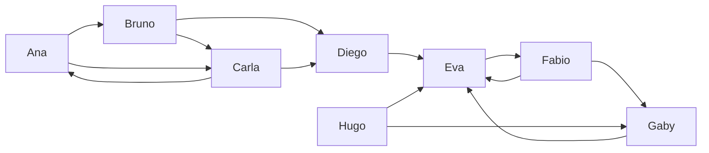

# Centrality

Centrality algorithms score each node by how important it is. "Important" has several meanings, and each algorithm measures one:

| Algorithm | A node scores high when it… |
| --- | --- |
| `algo.degree` | has many edges |
| `algo.pageRank` | is pointed to by nodes that are themselves pointed to |
| `algo.eigenvector` | is linked to high-scoring nodes |
| `algo.hits` | points to good sources (hub) or is pointed to by good hubs (authority) |
| `algo.betweenness` | sits on many shortest paths between others: a broker |
| `algo.closeness` | is near everyone else on average |
| `algo.harmonic` | is near everyone else, counting unreachable nodes as zero |

All of them yield `node` and a score, highest first, and take `top: n` to keep only the best `n`.

## The example data

Two groups of people who follow each other, joined through Diego:



```text run title="Example"
CREATE (ana:Person {name: 'Ana'}), (bruno:Person {name: 'Bruno'}), (carla:Person {name: 'Carla'}),
       (diego:Person {name: 'Diego'}), (eva:Person {name: 'Eva'}), (fabio:Person {name: 'Fabio'}),
       (gaby:Person {name: 'Gaby'}), (hugo:Person {name: 'Hugo'}),
       (ana)-[:follows]->(bruno), (bruno)-[:follows]->(carla), (carla)-[:follows]->(ana),
       (ana)-[:follows]->(carla), (bruno)-[:follows]->(diego), (carla)-[:follows]->(diego),
       (diego)-[:follows]->(eva), (eva)-[:follows]->(fabio), (fabio)-[:follows]->(gaby),
       (gaby)-[:follows]->(eva), (fabio)-[:follows]->(eva), (hugo)-[:follows]->(eva),
       (hugo)-[:follows]->(gaby);
```

```text result title="Result"
8 nodes created, 13 edges created
```

## algo.degree

The number of edges of each node (or the sum of their weights). `direction: 'in'` counts followers, `'out'` follows, `'both'` (default) all.

**Syntax:** `algo.degree({direction: 'both', weight, top, …})` yields `node`, `score`.

```text run title="Example"
CALL algo.degree({direction: 'in'}) YIELD node, score
RETURN node.name, score AS followers LIMIT 4;
```

```text result title="Result"
 node.name | followers
-----------+-----------
 Eva       | 4.0
 Carla     | 2.0
 Diego     | 2.0
 Gaby      | 2.0
(4 rows)
```

**Use it for:** a first look; the most connected accounts, products, airports.

## algo.pageRank

Each node passes its score along its edges; a node pointed to by high-scoring nodes scores high. Scores add up to 1.

**Syntax:** `algo.pageRank({damping: 0.85, iterations: 20, tolerance: 1e-7, sources, weight, top, …})` yields `node`, `score`.

```text run title="Example"
CALL algo.pageRank() YIELD node, score
RETURN node.name, round(score, 3) AS score;
```

```text result title="Result"
 node.name | score
-----------+-------
 Eva       | 0.337
 Fabio     | 0.305
 Gaby      | 0.156
 Diego     | 0.056
 Carla     | 0.051
 Ana       | 0.041
 Bruno     | 0.036
 Hugo      | 0.019
(8 rows)
```

Eva leads: Diego, Fabio, Gaby and Hugo all point to her, and the first group's score reaches her through Diego.

### Personalized PageRank

With `sources`, every jump lands on those nodes, so scores measure importance **from their point of view**: who matters to Ana?

```text run title="Example"
MATCH (a:Person {name: 'Ana'})
CALL algo.pageRank({sources: [a]}) YIELD node, score
RETURN node.name, round(score, 3) AS score LIMIT 4;
```

```text result title="Result"
 node.name | score
-----------+-------
 Eva       | 0.227
 Ana       | 0.202
 Fabio     | 0.193
 Carla     | 0.122
(4 rows)
```

**Use it for:** influence in a follower network, the key pages of a site, recommendations around one user (personalized).

## algo.eigenvector

A node's score is the sum of its neighbors' scores. With `direction: 'in'` (default), the score comes from those who point to the node.

**Syntax:** `algo.eigenvector({direction: 'in', iterations: 100, tolerance: 1e-6, weight, top, …})` yields `node`, `score`.

```text run title="Example"
CALL algo.eigenvector({top: 4}) YIELD node, score
RETURN node.name, round(score, 3) AS score;
```

```text result title="Result"
 node.name | score
-----------+-------
 Eva       | 0.733
 Fabio     | 0.544
 Gaby      | 0.404
 Diego     | 0.038
(4 rows)
```

**Use it for:** status in a network where links from important nodes count more; like PageRank without the random jumps.

## algo.hits

Two scores per node: **authority** (pointed to by good hubs) and **hub** (points to good authorities). Rows come by authority.

**Syntax:** `algo.hits({iterations: 20, tolerance: 1e-8, weight, top, …})` yields `node`, `hub`, `authority`.

```text run title="Example"
CALL algo.hits() YIELD node, hub, authority
RETURN node.name, round(hub, 3) AS hub, round(authority, 3) AS authority;
```

```text result title="Result"
 node.name | hub   | authority
-----------+-------+-----------
 Eva       | 0.0   | 0.851
 Gaby      | 0.372 | 0.526
 Carla     | 0.0   | 0.0
 Diego     | 0.372 | 0.0
 Ana       | 0.0   | 0.0
 Bruno     | 0.0   | 0.0
 Fabio     | 0.602 | 0.0
 Hugo      | 0.602 | 0.0
(8 rows)
```

**Use it for:** links between documents or sites, where some list good sources (hubs) and others are the sources (authorities).

## algo.betweenness

How many shortest paths between other nodes go through each node. High scores mark **brokers**: remove them and others drift apart.

**Syntax:** `algo.betweenness({direction: 'out', weight, sample, seed, top, …})` yields `node`, `score`.

```text run title="Example"
CALL algo.betweenness({direction: 'both'}) YIELD node, score
RETURN node.name, round(score, 2) AS score LIMIT 4;
```

```text result title="Result"
 node.name | score
-----------+-------
 Eva       | 12.67
 Diego     | 12.0
 Carla     | 3.33
 Bruno     | 1.67
(4 rows)
```

Diego and Eva connect the two groups. On a large graph, `sample: 1000` estimates the scores from 1 000 starting nodes instead of all.

**Use it for:** bottlenecks in a network, people who bridge teams, single points of failure.

## algo.closeness

How near a node is to everyone it reaches: the inverse of the average distance (Wasserman-Faust, adjusted for nodes that reach only part of the graph).

**Syntax:** `algo.closeness({direction: 'out', harmonic: false, weight, top, …})` yields `node`, `score`.

```text run title="Example"
CALL algo.closeness({direction: 'both'}) YIELD node, score
RETURN node.name, round(score, 3) AS score LIMIT 4;
```

```text result title="Result"
 node.name | score
-----------+-------
 Diego     | 0.636
 Eva       | 0.636
 Bruno     | 0.5
 Carla     | 0.5
(4 rows)
```

**Use it for:** where to place something everyone must reach quickly; who can spread news fastest.

## algo.harmonic

The sum of `1 / distance` to every other node. Unlike closeness it stays meaningful when some nodes are unreachable (they add 0).

**Syntax:** `algo.harmonic({direction: 'out', weight, top, …})` yields `node`, `score`.

```text run title="Example"
CALL algo.harmonic({direction: 'both', top: 4}) YIELD node, score
RETURN node.name, round(score, 3) AS score;
```

```text result title="Result"
 node.name | score
-----------+-------
 Eva       | 0.762
 Diego     | 0.714
 Bruno     | 0.643
 Carla     | 0.643
(4 rows)
```

## Compare them

Each measure tells a different story about the same people:

```text run title="Example"
CALL algo.pageRank() YIELD node, score WITH node, score AS pagerank
CALL algo.betweenness({direction: 'both'}) YIELD node AS n2, score AS between
WITH node, pagerank, n2, between WHERE node = n2
CALL algo.degree({direction: 'in'}) YIELD node AS n3, score AS followers
WITH node, pagerank, between, n3, followers WHERE node = n3
RETURN node.name, followers, round(pagerank, 3) AS pagerank, round(between, 1) AS betweenness
ORDER BY pagerank DESC;
```

```text result title="Result"
 node.name | followers | pagerank | betweenness
-----------+-----------+----------+-------------
 Eva       | 4.0       | 0.337    | 12.7
 Fabio     | 1.0       | 0.305    | 0.0
 Gaby      | 2.0       | 0.156    | 0.3
 Diego     | 2.0       | 0.056    | 12.0
 Carla     | 2.0       | 0.051    | 3.3
 Ana       | 1.0       | 0.041    | 0.0
 Bruno     | 1.0       | 0.036    | 1.7
 Hugo      | 0.0       | 0.019    | 0.0
(8 rows)
```

:::tip Weights
With `weight`, degree adds edge weights, PageRank and eigenvector pass more score along heavier edges, and betweenness, closeness and harmonic treat the weight as a distance.
:::
