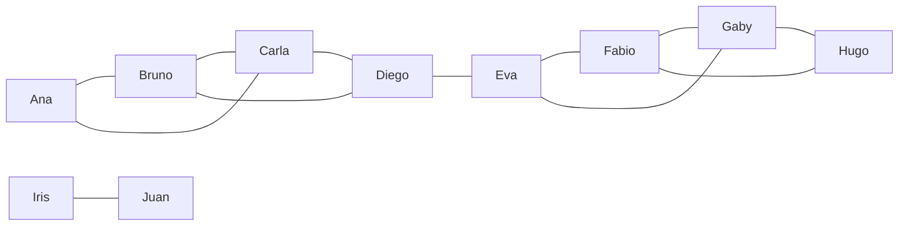

# Communities

Community algorithms split the graph into groups: parts that are connected at all, groups that are densely connected inside, cores where everyone has many links.

| Algorithm | Finds |
| --- | --- |
| `algo.wcc` | weakly connected components: parts linked at all, ignoring direction |
| `algo.scc` | strongly connected components: parts where everyone reaches everyone along the arrows |
| `algo.labelPropagation` | groups by spreading labels among neighbors, fast |
| `algo.louvain` | groups that maximize modularity (more edges inside than chance would give) |
| `algo.leiden` | Louvain's groups, each guaranteed connected |
| `algo.kCore` | each node's core number: how deep in a dense core it sits |
| `algo.triangles` | triangles per node and the local clustering coefficient |
| `algo.clustering` | the share of a node's neighbor pairs that are linked |
| `algo.conductance` | how closed each group is: the share of its edges that leave it |

Groups are numbered from 0 in node order.

## The example data

Two circles of friends joined by Diego and Eva, and a pair apart:



```text run title="Example"
CREATE (ana:Person {name: 'Ana'}), (bruno:Person {name: 'Bruno'}), (carla:Person {name: 'Carla'}),
       (diego:Person {name: 'Diego'}), (eva:Person {name: 'Eva'}), (fabio:Person {name: 'Fabio'}),
       (gaby:Person {name: 'Gaby'}), (hugo:Person {name: 'Hugo'}), (iris:Person {name: 'Iris'}),
       (juan:Person {name: 'Juan'}),
       (ana)-[:knows]->(bruno), (ana)-[:knows]->(carla), (bruno)-[:knows]->(carla),
       (bruno)-[:knows]->(diego), (carla)-[:knows]->(diego), (diego)-[:knows]->(eva),
       (eva)-[:knows]->(fabio), (eva)-[:knows]->(gaby), (fabio)-[:knows]->(gaby),
       (fabio)-[:knows]->(hugo), (gaby)-[:knows]->(hugo), (iris)-[:knows]->(juan);
```

```text result title="Result"
10 nodes created, 12 edges created
```

## algo.wcc

Weakly connected components: two nodes are in the same component when some chain of edges, in any direction, joins them.

**Syntax:** `algo.wcc({…})` yields `node`, `component`.

```text run title="Example"
CALL algo.wcc() YIELD node, component
RETURN component, collect(node.name) AS members ORDER BY component;
```

```text result title="Result"
 component | members
-----------+----------------------------------------------------
 0         | [Ana, Bruno, Carla, Diego, Eva, Fabio, Gaby, Hugo]
 1         | [Iris, Juan]
(2 rows)
```

**Use it for:** finding islands of data, checking that a graph is all connected, splitting work by part.

## algo.scc

Strongly connected components: everyone in a component reaches everyone else **following the arrows**.

**Syntax:** `algo.scc({…})` yields `node`, `component`.

Calls between services, where some call each other in loops:

```text run title="Example"
CREATE (a:Service {name: 'auth'}), (b:Service {name: 'billing'}), (c:Service {name: 'catalog'}),
       (d:Service {name: 'delivery'}), (e:Service {name: 'email'}),
       (a)-[:calls]->(b), (b)-[:calls]->(c), (c)-[:calls]->(a),
       (c)-[:calls]->(d), (d)-[:calls]->(e), (e)-[:calls]->(d);
CALL algo.scc({labels: 'Service'}) YIELD node, component
RETURN component, collect(node.name) AS members ORDER BY component;
```

```text result title="Result"
5 nodes created, 6 edges created
 component | members
-----------+--------------------------
 0         | [auth, billing, catalog]
 1         | [delivery, email]
(2 rows)
```

**Use it for:** loops of dependencies, groups of pages that all link to each other, cycles of payments.

## algo.labelPropagation

Every node starts with its own label and repeatedly takes the label most common among its neighbors, until groups settle.

**Syntax:** `algo.labelPropagation({iterations: 10, seed, weight, …})` yields `node`, `community`.

```text run title="Example"
CALL algo.labelPropagation({labels: 'Person'}) YIELD node, community
RETURN community, collect(node.name) AS members ORDER BY community;
```

```text result title="Result"
 community | members
-----------+----------------------------
 0         | [Ana, Bruno, Carla, Diego]
 1         | [Eva, Fabio, Gaby, Hugo]
 2         | [Iris, Juan]
(3 rows)
```

**Use it for:** a quick grouping of very large graphs.

## algo.louvain

Moves nodes between groups while **modularity** grows: a measure of how many more edges fall inside groups than chance would give. Yields the modularity too.

**Syntax:** `algo.louvain({resolution: 1, levels: 10, iterations: 10, weight, …})` yields `node`, `community`, `modularity`.

```text run title="Example"
CALL algo.louvain({labels: 'Person'}) YIELD node, community, modularity
RETURN community, collect(node.name) AS members, round(max(modularity), 3) AS modularity
ORDER BY community;
```

```text result title="Result"
 community | members                    | modularity
-----------+----------------------------+------------
 0         | [Ana, Bruno, Carla, Diego] | 0.49
 1         | [Eva, Fabio, Gaby, Hugo]   | 0.49
 2         | [Iris, Juan]               | 0.49
(3 rows)
```

A higher `resolution` gives smaller groups:

```text run title="Example"
CALL algo.louvain({labels: 'Person', resolution: 2.5}) YIELD node, community
RETURN community, collect(node.name) AS members ORDER BY community;
```

```text result title="Result"
 community | members
-----------+---------------------
 0         | [Ana, Bruno, Carla]
 1         | [Diego, Eva]
 2         | [Fabio, Gaby, Hugo]
 3         | [Iris, Juan]
(4 rows)
```

**Use it for:** communities in social networks, topics in a graph of documents, modules in software.

## algo.leiden

Louvain's groups, then each split into its connected parts, so no group is disconnected inside. Same settings as Louvain.

**Syntax:** `algo.leiden({resolution: 1, levels: 10, iterations: 10, weight, …})` yields `node`, `community`, `modularity`.

```text run title="Example"
CALL algo.leiden({labels: 'Person'}) YIELD node, community
RETURN community, collect(node.name) AS members ORDER BY community;
```

```text result title="Result"
 community | members
-----------+----------------------------
 0         | [Ana, Bruno, Carla, Diego]
 1         | [Eva, Fabio, Gaby, Hugo]
 2         | [Iris, Juan]
(3 rows)
```

**Use it for:** the same questions as Louvain when groups must be connected (for example, to summarize each).

## algo.kCore

A node's **core number** is the largest `k` such that it belongs to a part of the graph where every node has at least `k` neighbors in that part.

**Syntax:** `algo.kCore({…})` yields `node`, `core`.

```text run title="Example"
CALL algo.kCore({labels: 'Person'}) YIELD node, core
RETURN core, collect(node.name) AS members ORDER BY core DESC;
```

```text result title="Result"
 core | members
------+----------------------------------------------------
 2    | [Ana, Bruno, Carla, Diego, Eva, Fabio, Gaby, Hugo]
 1    | [Iris, Juan]
(2 rows)
```

**Use it for:** the dense heart of a network; peeling away loosely attached nodes before other analysis.

## algo.triangles

How many triangles each node is in, and its local clustering coefficient (the share of its neighbor pairs that are linked).

**Syntax:** `algo.triangles({…})` yields `node`, `triangles`, `coefficient`.

```text run title="Example"
CALL algo.triangles({labels: 'Person'}) YIELD node, triangles, coefficient
RETURN node.name, triangles, round(coefficient, 3) AS coefficient ORDER BY triangles DESC, node.name;
```

```text result title="Result"
 node.name | triangles | coefficient
-----------+-----------+-------------
 Bruno     | 2         | 0.667
 Carla     | 2         | 0.667
 Fabio     | 2         | 0.667
 Gaby      | 2         | 0.667
 Ana       | 1         | 1.0
 Diego     | 1         | 0.333
 Eva       | 1         | 0.333
 Hugo      | 1         | 1.0
 Iris      | 0         | 0.0
 Juan      | 0         | 0.0
(10 rows)
```

## algo.clustering

Only the clustering coefficient: 1 when all of a node's neighbors know each other, 0 when none do.

**Syntax:** `algo.clustering({…})` yields `node`, `coefficient`.

```text run title="Example"
CALL algo.clustering({labels: 'Person'}) YIELD node, coefficient
RETURN node.name, round(coefficient, 3) AS coefficient ORDER BY coefficient, node.name;
```

```text result title="Result"
 node.name | coefficient
-----------+-------------
 Iris      | 0.0
 Juan      | 0.0
 Diego     | 0.333
 Eva       | 0.333
 Bruno     | 0.667
 Carla     | 0.667
 Fabio     | 0.667
 Gaby      | 0.667
 Ana       | 1.0
 Hugo      | 1.0
(10 rows)
```

Iris and Juan have one neighbor each, so no pairs at all. Among the rest, Diego and Eva have the lowest coefficients: their neighbors are in different circles.

**Use it for:** how tightly knit a neighborhood is; spotting brokers (low clustering, high betweenness).

## algo.conductance

For groups given by an integer property (`community` by default): the weight of the edges that leave the group over the weight of all its edges. 0 is a closed group; near 1, a group in name only.

**Syntax:** `algo.conductance({property: 'community', …})` yields `community`, `conductance`.

Store Louvain's groups, then measure them:

```text run title="Example"
CALL algo.louvain({labels: 'Person', write: 'community'});
CALL algo.conductance({labels: 'Person'}) YIELD community, conductance
RETURN community, round(conductance, 3) AS conductance ORDER BY community;
```

```text result title="Result"
 property  | column    | nodes
-----------+-----------+-------
 community | community | 10
(1 row)
10 properties set
 community | conductance
-----------+-------------
 0         | 0.091
 1         | 0.091
 2         | 0.0
(3 rows)
```

**Use it for:** checking the quality of groups, from any algorithm or from your own data.

:::tip Directions
`wcc`, `labelPropagation`, `louvain`, `leiden`, `triangles`, `clustering` and `kCore` follow edges both ways: for them a friendship is a friendship whichever way it was written. `scc` follows the arrows.
:::
