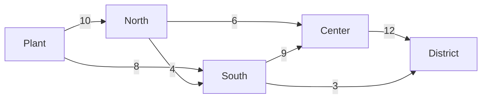

# Flows and matching

Edges can be pipes, roads or permissions: each carries at most a **capacity**, sometimes at a **cost**. These algorithms find the best use of them.

| Algorithm | Answers |
| --- | --- |
| `algo.maxFlow(source, sink)` | the most that can go from source to sink, and the edges that limit it |
| `algo.minCostFlow()` | the cheapest way to send each node's supply to the nodes that need it |
| `algo.bipartiteMatching()` | the most pairs between two kinds of nodes |
| `algo.assignment()` | each agent to a task, at least total cost |

## algo.maxFlow

The largest flow from `source` to `sink` along the edges' directions, each edge carrying at most its `weight`. One row per edge that carries flow; `value` is the total, and `cut` marks the edges of a **minimum cut**: the bottleneck.

**Syntax:** `algo.maxFlow(source, sink, {weight: capacity, …})` yields `edge`, `flow`, `value`, `cut`.

Water mains from a plant to a district, with capacities in liters per second:



```text run title="Example"
CREATE (plant:Node {name: 'Plant'}), (north:Node {name: 'North'}), (south:Node {name: 'South'}),
       (center:Node {name: 'Center'}), (district:Node {name: 'District'}),
       (plant)-[:main {capacity: 10}]->(north), (plant)-[:main {capacity: 8}]->(south),
       (north)-[:main {capacity: 4}]->(south), (north)-[:main {capacity: 6}]->(center),
       (south)-[:main {capacity: 9}]->(center), (center)-[:main {capacity: 12}]->(district),
       (south)-[:main {capacity: 3}]->(district);
MATCH (s:Node {name: 'Plant'}), (t:Node {name: 'District'})
CALL algo.maxFlow(s, t, {weight: 'capacity'}) YIELD edge, flow, value, cut
MATCH (a)-[edge]->(b)
RETURN a.name, b.name, flow, edge.capacity AS capacity, cut, value
ORDER BY a.name, b.name;
```

```text result title="Result"
5 nodes created, 7 edges created
 a.name | b.name   | flow | capacity | cut   | value
--------+----------+------+----------+-------+-------
 Center | District | 12.0 | 12       | true  | 15.0
 North  | Center   | 6.0  | 6        | false | 15.0
 North  | South    | 1.0  | 4        | false | 15.0
 Plant  | North    | 7.0  | 10       | false | 15.0
 Plant  | South    | 8.0  | 8        | false | 15.0
 South  | Center   | 6.0  | 9        | false | 15.0
 South  | District | 3.0  | 3        | true  | 15.0
(7 rows)
```

At most 15 liters per second reach the district. The cut edges, Center to District and South to District, are full: widening another main would not help.

**Use it for:** network capacity, evacuation routes, the bottleneck of a supply chain, how many independent paths join two nodes (capacity 1 each).

## algo.minCostFlow

Nodes **supply** (a property greater than 0) or **need** (less than 0) amounts. Edges carry at most their `capacity` property at `cost` per unit. The algorithm sends everything at least total cost; `unmet` is the supply no route could carry.

**Syntax:** `algo.minCostFlow({supply: property, capacity: property, cost: property, …})` yields `edge`, `flow`, `value`, `cost`, `unmet`. The three settings name the properties and are required.

Two warehouses ship to three stores:

```text run title="Example"
CREATE (w1:Site {name: 'Warehouse A', supply: 30}), (w2:Site {name: 'Warehouse B', supply: 20}),
       (s1:Site {name: 'Store 1', supply: -15}), (s2:Site {name: 'Store 2', supply: -20}),
       (s3:Site {name: 'Store 3', supply: -15}),
       (w1)-[:route {capacity: 20, cost: 4}]->(s1), (w1)-[:route {capacity: 20, cost: 6}]->(s2),
       (w1)-[:route {capacity: 20, cost: 9}]->(s3), (w2)-[:route {capacity: 20, cost: 7}]->(s1),
       (w2)-[:route {capacity: 20, cost: 3}]->(s2), (w2)-[:route {capacity: 20, cost: 5}]->(s3);
CALL algo.minCostFlow({labels: 'Site', supply: 'supply', capacity: 'capacity', cost: 'cost'}) YIELD edge, flow, value, cost, unmet
MATCH (a)-[edge]->(b)
RETURN a.name, b.name, flow, edge.cost AS unit_cost, cost AS total_cost, unmet
ORDER BY a.name, b.name;
```

```text result title="Result"
5 nodes created, 6 edges created
 a.name      | b.name  | flow | unit_cost | total_cost | unmet
-------------+---------+------+-----------+------------+-------
 Warehouse A | Store 1 | 15.0 | 4         | 240.0      | 0.0
 Warehouse A | Store 2 | 15.0 | 6         | 240.0      | 0.0
 Warehouse B | Store 2 | 5.0  | 3         | 240.0      | 0.0
 Warehouse B | Store 3 | 15.0 | 5         | 240.0      | 0.0
(4 rows)
```

Every store gets what it needs for 240 in total. Warehouse B's 20 go where it is cheapest (Store 3, and 5 to Store 2 at 3 each); Warehouse A covers the rest.

**Use it for:** distribution and logistics, moving staff or stock between places, any transport problem.

## algo.bipartiteMatching

Two kinds of nodes, and edges between them that say who may pair with whom. The algorithm finds the most pairs, each node in at most one. Nodes with the label `left` are one side; the rest the other.

**Syntax:** `algo.bipartiteMatching({left: label, …})` yields `left`, `right`, `edge`.

Mentors and the students each can mentor:

```text run title="Example"
CREATE (m1:Mentor {name: 'Ana'}), (m2:Mentor {name: 'Bruno'}), (m3:Mentor {name: 'Carla'}),
       (s1:Student {name: 'Diego'}), (s2:Student {name: 'Eva'}), (s3:Student {name: 'Fabio'}),
       (m1)-[:can_mentor]->(s1), (m1)-[:can_mentor]->(s2),
       (m2)-[:can_mentor]->(s1),
       (m3)-[:can_mentor]->(s2), (m3)-[:can_mentor]->(s3);
CALL algo.bipartiteMatching({labels: ['Mentor', 'Student'], left: 'Mentor'}) YIELD left, right
RETURN left.name AS mentor, right.name AS student ORDER BY mentor;
```

```text result title="Result"
6 nodes created, 5 edges created
 mentor | student
--------+---------
 Ana    | Eva
 Bruno  | Diego
 Carla  | Fabio
(3 rows)
```

Bruno can only take Diego, so Ana takes Eva and Carla takes Fabio: everyone is paired.

**Use it for:** pairing people with roles, rooms with events, jobs with machines, when any allowed pair is as good as another.

## algo.assignment

Each agent (label `agents`) to one task (label `tasks`), where an edge between them is allowed and its `weight` is the cost; the total cost is the least possible.

**Syntax:** `algo.assignment({agents: label, tasks: label, weight: cost, …})` yields `agent`, `task`, `cost`.

Three drivers, three deliveries, minutes each driver needs:

```text run title="Example"
CREATE (d1:Driver {name: 'Ana'}), (d2:Driver {name: 'Bruno'}), (d3:Driver {name: 'Carla'}),
       (j1:Delivery {name: 'Airport'}), (j2:Delivery {name: 'Harbor'}), (j3:Delivery {name: 'Downtown'}),
       (d1)-[:can_do {minutes: 30}]->(j1), (d1)-[:can_do {minutes: 25}]->(j2), (d1)-[:can_do {minutes: 10}]->(j3),
       (d2)-[:can_do {minutes: 20}]->(j1), (d2)-[:can_do {minutes: 40}]->(j2), (d2)-[:can_do {minutes: 15}]->(j3),
       (d3)-[:can_do {minutes: 35}]->(j1), (d3)-[:can_do {minutes: 20}]->(j2), (d3)-[:can_do {minutes: 30}]->(j3);
CALL algo.assignment({labels: ['Driver', 'Delivery'], agents: 'Driver', tasks: 'Delivery', weight: 'minutes'})
YIELD agent, task, cost
RETURN agent.name, task.name, cost ORDER BY agent.name;
```

```text result title="Result"
6 nodes created, 9 edges created
 agent.name | task.name | cost
------------+-----------+------
 Ana        | Downtown  | 10.0
 Bruno      | Airport   | 20.0
 Carla      | Harbor    | 20.0
(3 rows)
```

Ana takes Downtown even though Bruno is also fast there: Bruno is the best at the Airport, and the total, 50 minutes, is the least of all six possible plans.

**Use it for:** staff to shifts, vehicles to orders, reviewers to papers, any one-to-one plan with costs.
