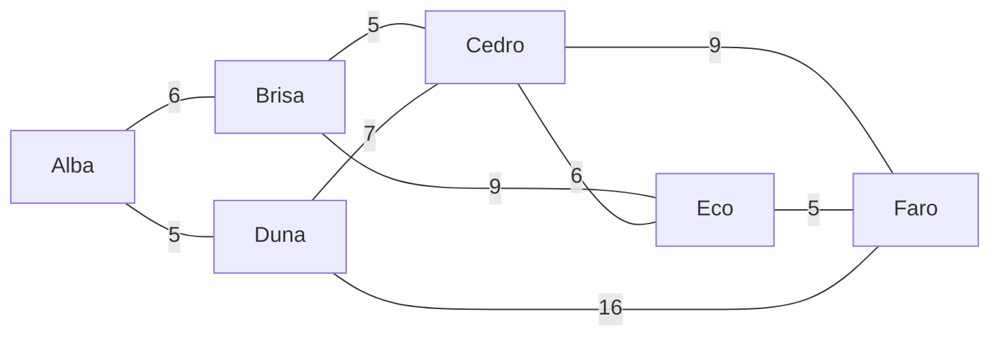

# Path algorithms

Find routes through the graph weighted by a property: kilometers, minutes, cost, risk.

| Algorithm | Answers |
| --- | --- |
| `algo.shortestPath(a, b)` | the cheapest route from `a` to `b` (Dijkstra) |
| `algo.astar(a, b)` | the same, faster on maps, guided by coordinates (A*) |
| `algo.kShortestPaths(a, b, k)` | the `k` cheapest routes, cheapest first |
| `algo.allShortestPaths(a, b)` | every route tied for cheapest |
| `algo.distances(a)` | the cost from `a` to every place it reaches |

## The example data

Six towns on a map (coordinates in km) and the roads between them, with their length in km. Roads go both ways, so the calls say `direction: 'both'`:



```text run title="Example"
CREATE (alba:Town {name: 'Alba', x: 0, y: 0}), (brisa:Town {name: 'Brisa', x: 4, y: 3}),
       (cedro:Town {name: 'Cedro', x: 8, y: 0}), (duna:Town {name: 'Duna', x: 4, y: -3}),
       (eco:Town {name: 'Eco', x: 12, y: 3}), (faro:Town {name: 'Faro', x: 16, y: 0}),
       (alba)-[:road {km: 6}]->(brisa), (alba)-[:road {km: 5}]->(duna),
       (brisa)-[:road {km: 5}]->(cedro), (duna)-[:road {km: 7}]->(cedro),
       (brisa)-[:road {km: 9}]->(eco), (cedro)-[:road {km: 6}]->(eco),
       (cedro)-[:road {km: 9}]->(faro), (eco)-[:road {km: 5}]->(faro),
       (duna)-[:road {km: 16}]->(faro);
```

```text result title="Result"
6 nodes created, 9 edges created
```

## algo.shortestPath

The cheapest route by `weight`. Without `weight`, the route with the fewest edges.

**Syntax:** `algo.shortestPath(source, target, {weight, direction: 'out', …})` yields `nodes`, `edges`, `cost`.

```text run title="Example"
MATCH (a:Town {name: 'Alba'}), (b:Town {name: 'Faro'})
CALL algo.shortestPath(a, b, {weight: 'km', direction: 'both'}) YIELD nodes, cost
RETURN [t IN nodes | t.name] AS route, cost;
```

```text result title="Result"
 route                      | cost
----------------------------+------
 [Alba, Brisa, Cedro, Faro] | 20.0
(1 row)
```

The fewest roads, ignoring length:

```text run title="Example"
MATCH (a:Town {name: 'Alba'}), (b:Town {name: 'Faro'})
CALL algo.shortestPath(a, b, {direction: 'both'}) YIELD nodes, cost
RETURN [t IN nodes | t.name] AS route, cost AS roads;
```

```text result title="Result"
 route              | roads
--------------------+-------
 [Alba, Duna, Faro] | 2.0
(1 row)
```

**Use it for:** routes on a map, the cheapest chain of transfers, the shortest chain of introductions between two people.

## algo.astar

The same answer as `shortestPath`, found by looking first toward the target, using node coordinates: `x` and `y` (straight-line distance), or `latitude` and `longitude` (km on the Earth). The weights must never be shorter than the straight line, or A* may miss the best route.

**Syntax:** `algo.astar(source, target, {weight, x: 'x', y: 'y' | latitude, longitude, …})` yields `nodes`, `edges`, `cost`.

```text run title="Example"
MATCH (a:Town {name: 'Alba'}), (b:Town {name: 'Faro'})
CALL algo.astar(a, b, {weight: 'km', x: 'x', y: 'y', direction: 'both'}) YIELD nodes, cost
RETURN [t IN nodes | t.name] AS route, cost;
```

```text result title="Result"
 route                      | cost
----------------------------+------
 [Alba, Brisa, Cedro, Faro] | 20.0
(1 row)
```

**Use it for:** large road or grid maps, where looking toward the goal saves most of the search.

## algo.kShortestPaths

The `k` cheapest routes without loops (Yen's algorithm), cheapest first.

**Syntax:** `algo.kShortestPaths(source, target, k, {weight, …})` yields `rank`, `nodes`, `edges`, `cost`.

```text run title="Example"
MATCH (a:Town {name: 'Alba'}), (b:Town {name: 'Faro'})
CALL algo.kShortestPaths(a, b, 4, {weight: 'km', direction: 'both'}) YIELD rank, nodes, cost
RETURN rank, [t IN nodes | t.name] AS route, cost;
```

```text result title="Result"
 rank | route                      | cost
------+----------------------------+------
 1    | [Alba, Brisa, Cedro, Faro] | 20.0
 2    | [Alba, Brisa, Eco, Faro]   | 20.0
 3    | [Alba, Duna, Faro]         | 21.0
 4    | [Alba, Duna, Cedro, Faro]  | 21.0
(4 rows)
```

**Use it for:** alternatives when the best route is closed, or to offer a choice.

## algo.allShortestPaths

Every route whose cost ties with the cheapest, at most `limit` (100).

**Syntax:** `algo.allShortestPaths(source, target, {weight, limit: 100, …})` yields `nodes`, `edges`, `cost`.

```text run title="Example"
MATCH (a:Town {name: 'Alba'}), (b:Town {name: 'Faro'})
CALL algo.allShortestPaths(a, b, {weight: 'km', direction: 'both'}) YIELD nodes, cost
RETURN [t IN nodes | t.name] AS route, cost;
```

```text result title="Result"
 route                      | cost
----------------------------+------
 [Alba, Brisa, Cedro, Faro] | 20.0
 [Alba, Brisa, Eco, Faro]   | 20.0
(2 rows)
```

**Use it for:** seeing whether the best route is unique, or spreading load across equal routes.

## algo.distances

The cost from one node to every node it reaches, nearest first.

**Syntax:** `algo.distances(source, {weight, …})` yields `node`, `cost`.

```text run title="Example"
MATCH (a:Town {name: 'Alba'})
CALL algo.distances(a, {weight: 'km', direction: 'both'}) YIELD node, cost
RETURN node.name, cost;
```

```text result title="Result"
 node.name | cost
-----------+------
 Alba      | 0.0
 Duna      | 5.0
 Brisa     | 6.0
 Cedro     | 11.0
 Eco       | 15.0
 Faro      | 20.0
(6 rows)
```

Combine it with a filter: the towns within 12 km of Alba:

```text run title="Example"
MATCH (a:Town {name: 'Alba'})
CALL algo.distances(a, {weight: 'km', direction: 'both'}) YIELD node, cost
WHERE cost <= 12 AND node <> a
RETURN node.name, cost;
```

```text result title="Result"
 node.name | cost
-----------+------
 Duna      | 5.0
 Brisa     | 6.0
 Cedro     | 11.0
(3 rows)
```

**Use it for:** service areas, "everything within 30 minutes", the nearest of many places (or use [algo.distanceField](simulation.md#algodistancefield) from several sources at once).

:::tip Hops, not weights
For the fewest hops on unweighted edges, the GQ pattern `shortestPath((a)-[*]-(b))` works too, see [Paths](../gq/paths.md).
:::
