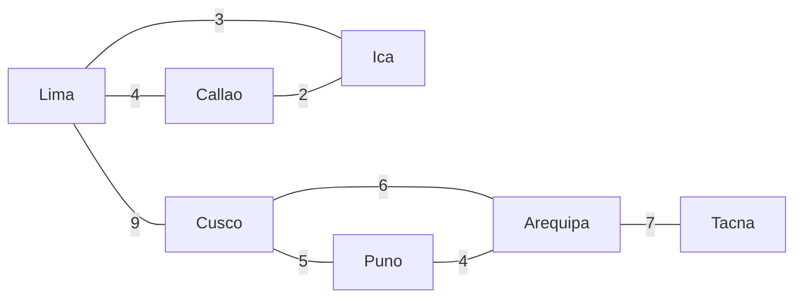

# Structure

These algorithms look at the skeleton of the graph: what holds it together, how to connect it at least cost, and in what order its parts can go.

| Algorithm | Finds |
| --- | --- |
| `algo.articulationPoints` | nodes whose removal splits their part of the graph |
| `algo.bridges` | edges whose removal splits their part of the graph |
| `algo.spanningTree` | the cheapest set of edges that keeps every node connected |
| `algo.topologicalOrder` | an order where every edge points forward |
| `algo.cycle` | one cycle, if there is any |

## The example data

Offices joined by network links, with the cost of each link:



```text run title="Example"
CREATE (lima:Office {name: 'Lima'}), (callao:Office {name: 'Callao'}), (ica:Office {name: 'Ica'}),
       (cusco:Office {name: 'Cusco'}), (puno:Office {name: 'Puno'}), (arequipa:Office {name: 'Arequipa'}),
       (tacna:Office {name: 'Tacna'}),
       (lima)-[:link {cost: 4}]->(callao), (lima)-[:link {cost: 3}]->(ica), (callao)-[:link {cost: 2}]->(ica),
       (lima)-[:link {cost: 9}]->(cusco), (cusco)-[:link {cost: 5}]->(puno),
       (cusco)-[:link {cost: 6}]->(arequipa), (puno)-[:link {cost: 4}]->(arequipa),
       (arequipa)-[:link {cost: 7}]->(tacna);
```

```text result title="Result"
7 nodes created, 8 edges created
```

## algo.articulationPoints

Nodes that, if they failed, would cut their part of the graph in two. Edges count in both directions.

**Syntax:** `algo.articulationPoints({…})` yields `node`.

```text run title="Example"
CALL algo.articulationPoints({labels: 'Office'}) YIELD node RETURN node.name ORDER BY node.name;
```

```text result title="Result"
 node.name
-----------
 Arequipa
 Cusco
 Lima
(3 rows)
```

Lima joins the coast to the south; Cusco joins Lima to the south; Arequipa is Tacna's only way in.

**Use it for:** single points of failure in networks, supply chains, organizations.

## algo.bridges

Edges that, if cut, would split their part of the graph.

**Syntax:** `algo.bridges({…})` yields `edge`.

```text run title="Example"
CALL algo.bridges({labels: 'Office'}) YIELD edge
MATCH (a)-[edge]->(b)
RETURN a.name, b.name, edge.cost;
```

```text result title="Result"
 a.name   | b.name | edge.cost
----------+--------+-----------
 Lima     | Cusco  | 9
 Arequipa | Tacna  | 7
(2 rows)
```

The other links each sit on a loop, so another way remains if one is cut.

**Use it for:** links worth doubling; the weak ties between communities.

## algo.spanningTree

A minimum spanning forest: the edges of least total `weight` that keep every node reachable (one tree per connected part). `maximum: true` takes the heaviest instead.

**Syntax:** `algo.spanningTree({weight, maximum: false, …})` yields `edge`, `weight`.

```text run title="Example"
CALL algo.spanningTree({labels: 'Office', weight: 'cost'}) YIELD edge, weight
MATCH (a)-[edge]->(b)
RETURN a.name, b.name, weight ORDER BY weight;
```

```text result title="Result"
 a.name   | b.name   | weight
----------+----------+--------
 Callao   | Ica      | 2.0
 Lima     | Ica      | 3.0
 Puno     | Arequipa | 4.0
 Cusco    | Puno     | 5.0
 Arequipa | Tacna    | 7.0
 Lima     | Cusco    | 9.0
(6 rows)
```

```text run title="Example"
CALL algo.spanningTree({labels: 'Office', weight: 'cost'}) YIELD weight
RETURN count(*) AS links, sum(weight) AS total_cost;
```

```text result title="Result"
 links | total_cost
-------+------------
 6     | 30.0
(1 row)
```

Six links costing 30 in total connect all seven offices; the full network has eight links costing 40.

**Use it for:** the cheapest cabling, pipes or roads that connect everything; a backbone to draw a large graph.

## algo.topologicalOrder

An order of the nodes in which every edge goes from an earlier node to a later one: an order to do tasks that depend on each other. A cycle makes it impossible, and the query fails naming the cycle.

**Syntax:** `algo.topologicalOrder({…})` yields `node`, `position`.

Steps of a build, each pointing to the steps that need it:

```text run title="Example"
CREATE (fetch:Task {name: 'fetch'}), (compile:Task {name: 'compile'}), (test:Task {name: 'test'}),
       (docs:Task {name: 'docs'}), (package:Task {name: 'package'}), (release:Task {name: 'release'}),
       (fetch)-[:before]->(compile), (compile)-[:before]->(test), (compile)-[:before]->(docs),
       (test)-[:before]->(package), (docs)-[:before]->(package), (package)-[:before]->(release);
CALL algo.topologicalOrder({labels: 'Task'}) YIELD node, position
RETURN position, node.name;
```

```text result title="Result"
6 nodes created, 6 edges created
 position | node.name
----------+-----------
 0        | fetch
 1        | compile
 2        | test
 3        | docs
 4        | package
 5        | release
(6 rows)
```

**Use it for:** build and job schedulers, course prerequisites, migrations in order.

## algo.cycle

One cycle in the order of its nodes, or no row when there is none.

**Syntax:** `algo.cycle({…})` yields `nodes`.

```text run title="Example"
CALL algo.cycle({labels: 'Task'}) YIELD nodes RETURN [n IN nodes | n.name] AS cycle;
```

```text result title="Result"
 cycle
-------
(0 rows)
```

None yet. Add a step that loops back:

```text run title="Example"
MATCH (r:Task {name: 'release'}), (c:Task {name: 'compile'}) CREATE (r)-[:before]->(c);
CALL algo.cycle({labels: 'Task'}) YIELD nodes RETURN [n IN nodes | n.name] AS cycle;
```

```text result title="Result"
1 edge created
 cycle
-----------------------------------
 [test, package, release, compile]
(1 row)
```

Now the order cannot exist:

```text run title="Example"
CALL algo.topologicalOrder({labels: 'Task'}) YIELD node, position RETURN count(*);
```

```text result title="Result"
error: the edges make a cycle, so there is no topological order: 01a1cb1f-3851-754f-a9e0-200e0b86ec93 → 01a1cb1f-3851-7551-a0a2-f52003d48208 → 01a1cb1f-3851-7552-83a9-b155e5068225 → 01a1cb1f-3851-754e-9ed4-06f9fc59b289
```

**Use it for:** finding circular dependencies, loops of payments, deadlocks.
