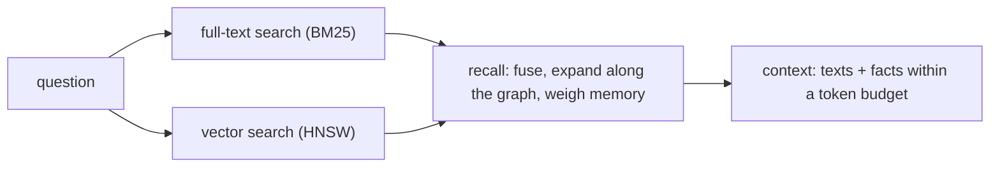

# Search and recall

An agent asks a question; it needs the few things in memory that matter, small enough to fit the model's window, and citable. Grafeno answers in four layers, each built on the one before.



## Full-text search

Text you put in `@text` is indexed. Search ranks with BM25, the classic relevance score of search engines:

```text
CALL db.search('telemetry', 5) YIELD node, score RETURN node.title, score;
```

In the console: `\search telemetry`. Over HTTP: `POST /v1/{namespace}/search/text` with `{"query": "telemetry", "limit": 5}`.

## Vector search

Text search finds words; vector search finds *meaning*. Give a node an embedding — a list of numbers your embedding model produced — and Grafeno finds the nearest ones:

```text
CREATE (:Doc {title: 'cats', @embedding: [1.0, 0.0, 0.0]}),
       (:Doc {title: 'dogs', @embedding: [0.9, 0.1, 0.0]}),
       (:Doc {title: 'cars', @embedding: [0.0, 0.0, 1.0]});

CALL db.searchVector([1.0, 0.05, 0.0], 2) YIELD node, score RETURN node.title, score;
```

```text
 node.title | score
------------+--------------------
 cats       | 0.9987523555755615
 dogs       | 0.9981583952903748
(2 rows)
```

:::info Grafeno does not call a model
Grafeno stores and searches embeddings; it never computes them. Your application (or agent) calls the embedding model of its choice and sends the vectors. Real embeddings have hundreds of dimensions; every node of a namespace must use the same.
:::

The index is HNSW with compact int8 copies, rescored exactly: on 20,000 clustered vectors it finds 99.6% of the true ten nearest in about 0.4 ms, and it stays accurate while vectors are added, changed and deleted.

## Recall

Recall combines both searches and the graph. It ranks by text and by meaning, fuses the rankings, follows facts from the best hits to related nodes, and weighs what memory knows: how important a node is (`@importance`, from 0 to 1) and how recently it was used.

```bash
curl -X POST http://127.0.0.1:7810/v1/demo/recall \
  -H "Authorization: Bearer $TOKEN" -H 'content-type: application/json' \
  -d '{"text": "who leads robotics?", "limit": 3}'
```

Each result says why it was found, in `signals`:

```json
[{"node": {"labels": ["Person"], "props": {"name": "Ana Torres"}, "…": "…"},
  "score": 0.0254,
  "signals": [{"kind": "text", "rank": 1, "score": 0.575},
              {"kind": "memory", "importance": 0.5, "recency": 0.99}]}]
```

Send `embedding` with the question's vector too, and recall uses meaning as well as words. In the console: `\recall who leads robotics?`.

### Following the graph

From the best few matches (`seeds`, 5), recall follows facts `depth` hops (1) and passes each node reached a share of the seed's score: half per hop (`decay`), and less through nodes with many edges. A node linked to almost everything (the user, the current project, a common tag) would otherwise collect score from every match and show up in every answer; recall divides the share along an edge by `sqrt((1 + hubs × ln d₁)(1 + hubs × ln d₂))`, where d₁ and d₂ are the edges of its two ends, and follows at most `fanout` neighbors (100) from each node, those the search found first. All of them go in `expand`:

```bash
curl -X POST http://127.0.0.1:7810/v1/demo/recall \
  -H "Authorization: Bearer $TOKEN" -H 'content-type: application/json' \
  -d '{"text": "what did the platform team decide?", "expand": {"depth": 3, "hubs": 1, "fanout": 100}}'
```

`"expand": false` turns it off; `"hubs": 0` and `"fanout": 0` give the undamped expansion of earlier engines. The engine's repository has an example where the answer only comes back through the graph — a decision three hops from the person asked about, whose text names neither the person nor the team — with what text search alone finds and what undamped hubs do to it: `cargo run -p grafeno-memory --example multi_hop`.

## Context

Context is what you hand the model: the recalled texts plus the facts around them, written as plain sentences, cut to a token budget.

```bash
curl -X POST http://127.0.0.1:7810/v1/demo/context \
  -H "Authorization: Bearer $TOKEN" -H 'content-type: application/json' \
  -d '{"text": "who leads robotics?", "budget": 300}'
```

```json
{"items": [{"name": "Ana Torres", "labels": ["Person"], "text": "Ana leads the robotics team at Acme.", "…": "…"}],
 "facts": [{"label": "works_at", "text": "Ana Torres works_at Acme Robotics (from 2021-03-01)", "…": "…"}],
 "tokens": 66,
 "rendered": "## Memory\n[1] Ana Torres (Person)\nAna leads the robotics team at Acme.\n…"}
```

Without a tokenizer the engine counts tokens on the safe side: a token per four ASCII letters, three digits, or any other character (punctuation, symbols, accented letters, other scripts), so code, data and text outside English do not overflow the budget. `rendered` is ready to paste into a prompt; `items` and `facts` keep the ids, so the model's answer can cite them. Options: `fact_share` (how much of the budget goes to facts), `max_facts`, and `communities` to add summaries of the [communities](../guides/agent-memory.md#summaries-of-what-belongs-together) that match.

## Through MCP

Agents connected over [MCP](../guides/mcp.md) get the same as tools: `recall` and `context`.
