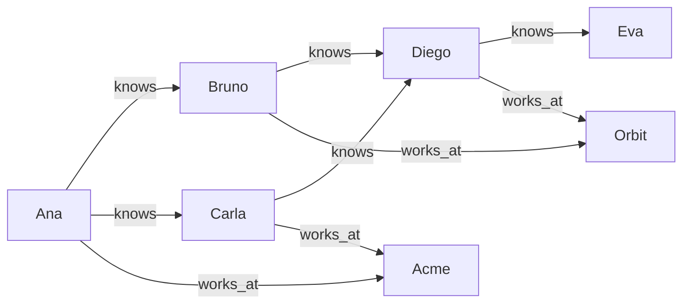

# GQ tutorial

GQ is the language you use to ask Grafeno questions and to change its data. A GQ statement describes **patterns** of nodes and edges, the way you would draw them on a whiteboard:

```text
(ana:Person)-[:works_at]->(acme:Company)
```

Round brackets are **nodes**, square brackets with an arrow are **edges** (also called facts). This tutorial goes through the language one feature at a time. Every page explains a feature, shows its syntax, and gives examples together with the exact answer Grafeno returns.

## How to follow along

Open a console with a throwaway database and type or paste each example:

```bash
grafeno shell --memory
```

Statements end with `;` and may span several lines. Results print as tables:

```text run title="Example"
RETURN 'Hello, graph' AS greeting, 6 * 7 AS answer;
```

```text result title="Result"
 greeting     | answer
--------------+--------
 Hello, graph | 42
(1 row)
```

To work against an installed engine instead, connect with its settings file (`grafeno shell --config /etc/grafeno/grafeno.toml`), or send statements over HTTP (see [Parameters](parameters.md)). Grafeno Studio has a query editor that shows the same results as a table or as a drawing.

## The example data

Most pages start from the same small graph: five people, the companies two of them work at, and who knows whom. Each page creates it again at the top, so every page works on its own:



```text run title="Example"
CREATE (ana:Person {name: 'Ana', age: 34, city: 'Lima'}),
       (bruno:Person {name: 'Bruno', age: 28, city: 'Quito'}),
       (carla:Person {name: 'Carla', age: 45, city: 'Lima'}),
       (diego:Person {name: 'Diego', age: 39, city: 'Bogotá'}),
       (eva:Person {name: 'Eva', age: 23, city: 'Quito'}),
       (acme:Company {name: 'Acme', sector: 'robotics'}),
       (orbit:Company {name: 'Orbit', sector: 'software'}),
       (ana)-[:works_at {since: 2019}]->(acme),
       (carla)-[:works_at {since: 2015}]->(acme),
       (bruno)-[:works_at {since: 2022}]->(orbit),
       (diego)-[:works_at {since: 2020}]->(orbit),
       (ana)-[:knows]->(bruno), (ana)-[:knows]->(carla),
       (bruno)-[:knows]->(diego), (carla)-[:knows]->(diego),
       (diego)-[:knows]->(eva);
```

```text result title="Result"
7 nodes created, 9 edges created
```

Check what is there:

```text run title="Example"
MATCH (p:Person) RETURN p.name, p.age, p.city ORDER BY p.name;
```

```text result title="Result"
 p.name | p.age | p.city
--------+-------+--------
 Ana    | 34    | Lima
 Bruno  | 28    | Quito
 Carla  | 45    | Lima
 Diego  | 39    | Bogotá
 Eva    | 23    | Quito
(5 rows)
```

## The rules in one place

- Every node has at least one **label** (`Person`) and any number of **properties** (`name: 'Ana'`). Every edge has exactly one label and a direction.
- Keywords (`MATCH`, `match`) are not case-sensitive; labels, property names and variables are.
- Strings go in single or double quotes. `//` starts a comment.
- Ids are generated by Grafeno (UUIDs). You read them as `n.@id`; names that start with `@` are [pseudo-properties](../reference/gq.md#pseudo-properties), fields of the engine rather than your data.
- Every statement runs in one **namespace** and in one transaction: all of its changes happen, or none.

## What is in this tutorial

| Part | Pages |
| --- | --- |
| Basics | [CREATE](create.md), [MATCH](match.md), [WHERE](where.md), [RETURN](return.md), [Aggregation](aggregation.md), [WITH](with.md) |
| Changing data | [SET and REMOVE](set-remove.md), [MERGE](merge.md), [DELETE](delete.md), [UNWIND and FOREACH](unwind-foreach.md) |
| Combining queries | [UNION and subqueries](union-subqueries.md), [Paths](paths.md) |
| Values and functions | [Strings](strings.md), [Numbers](numbers.md), [Lists and maps](lists-maps.md), [Conditions](conditions.md), [Dates and durations](dates.md), [Time travel](time-travel.md) |
| Search | [Full-text search](full-text.md), [Similar text](similar-text.md); vectors have [their own section](../vectors/index.md) |
| Schema and operation | [Indexes](indexes.md), [Constraints](constraints.md), [Procedures](procedures.md), [Transactions](transactions.md), [Namespaces](namespaces.md), [Event subscriptions](events.md), [EXPLAIN, PROFILE and TRACE](explain-profile-trace.md), [Parameters](parameters.md) |

Graph algorithms (shortest paths, centrality, communities, flows, simulations) are in [their own section](../algorithms/index.md).
