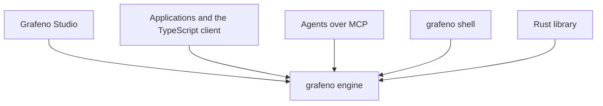

import useBaseUrl from '@docusaurus/useBaseUrl';

# Introduction

<a href={useBaseUrl('/img/grafeno-banner.svg')} aria-label="Open the full-resolution Grafeno image">
  
</a>

Grafeno is a graph engine written in Rust. It stores entities, documents and facts, keeps where each piece of data came from and when it was true, and assembles context by combining text, vectors and relationships.

It is memory and a knowledge base for agents. An application can use it embedded, over HTTP, or over MCP.

Grafeno is the engine alone, as a database server is. The `grafeno` binary serves the HTTP API, the MCP server, the console and the administration commands. **Grafeno Studio**, the interface, is a separate product that connects to an engine through that API, like any other client.

:::tip New here? Follow the guide in order
1. [Install Grafeno](./get-started/install.md) — the engine, on Windows or Linux, in a few minutes.
2. [Your first graph](./get-started/first-graph.md) — people, companies and dated facts, step by step in the console.
3. [Grafeno Studio](./get-started/studio.md) — the same graph, drawn and edited in the desktop app.
4. Then the ideas behind it: [Data model](./concepts/data-model.md), [Time](./concepts/time.md), [Search and recall](./concepts/search-and-recall.md).
:::

## What it is for

An agent needs more than the last message. It needs people, organizations, documents and facts, with the date each one was true and the source it came from. Given a question, it needs context that fits the model's window and that can be cited.

Grafeno is that data layer.

- **An agent's memory.** Episodes, entities and facts in one file. The model extracts and embeds; Grafeno stores, relates, searches and packs the context. The engine is not tied to a model provider.
- **An application's knowledge.** A client can sync a note, its chunks and its links in one transaction. The client may choose a node's id, so repeating the write does not duplicate the data.
- **Isolated spaces.** Every piece of data lives in a namespace: a person, an organization or an agent. A query does not cross namespaces unless you ask it to.
- **Several servers.** A Raft cluster replicates writes, elects a leader, fails over to another member and splits large reads. A whole namespace can live on a different group. A namespace is not split across servers.



## Features

### Property graph

A node has one or more labels and JSON properties. A relationship is directed, has a label and has properties too. Every node needs a label: a `CREATE` without one is refused. Identifiers are UUID v7, time-ordered, generated by the engine.

Data lives in one [redb](https://github.com/cberner/redb) file: ACID, several readers and one writer per Raft group. An in-memory backend exists for tests and short-lived agents.

### Two times on every fact

Grafeno does not erase history when it corrects it. On every relationship it distinguishes when the fact was true in the world from when the engine learned it.

| Axis | Fields | Question |
| --- | --- | --- |
| Valid time | `valid_from`, `valid_to` | When was it true? |
| Record time | `recorded_at`, `expired_at` | When did the engine learn it, and when was it retracted? |

- With no time clause, a read sees current knowledge: relationships that have not been retracted, whatever their valid time.
- `VALID AT t` keeps the facts that were true at that instant (`valid_from <= t < valid_to`).
- `KNOWN AT t` shows what the engine knew then, including facts retracted later.
- Invalidating closes valid time: the world changed. Retracting closes record time: the data was a mistake. Deleting exists, and it is a different operation.

`t` is an ISO 8601 date, a value such as `datetime()`, or microseconds since the Unix epoch.

### Provenance

Nodes and relationships keep `sources`: the nodes they came from, such as an episode, a document, a chunk or a conversation. That supports citation and inheriting permissions. Every write records the account that made it (`recorded_by`).

### GQ

GQ is the query language: a declarative language of graph patterns, with time, retraction and pseudo-properties for what is not a property (`@id`, `@text`, `@embedding`, `@valid_from`, `@recorded_by`, and others). It runs in the console, at `POST /v1/{namespace}/query`, in the read-only MCP tool `query`, and from Rust.

```text
CREATE (a:Person {name: 'Ana'})
  -[:works_at {@valid_from: '2024-01-01'}]->
  (h:Organization {name: 'Hospital Central'})
RETURN a.name, h.name;
```

```text
MATCH (p:Person)-[r:works_at]->(o:Organization)
VALID AT '2024-06-01'
RETURN p.name, o.name, r.@valid_from;
```

It covers patterns, filters, aggregates, writes, `OPTIONAL MATCH`, `MERGE`, `WITH`, `UNWIND` and `UNION`, plus indexes and algorithms for paths, centrality, communities and similarity. Three choices matter from the start: every node needs a label; a variable-length path reaches each end node once, by the shortest path; the id is a UUID, not an integer. Clients connect over the HTTP API or MCP: there is no binary wire protocol.

The full reference still lives in the engine repository, in [`docs/query-language.md`](https://github.com/grafenodb/grafeno/blob/main/docs/query-language.md), until it moves to this site.

### Hybrid retrieval

For a question, the engine can combine three signals and fuse them with reciprocal rank fusion (`k = 60`):

1. **Text**, with BM25. The index lives in the same file and the same transaction as the graph.
2. **Vectors**, with HNSW and cosine similarity. The client sends the embedding. The namespace's dimension is fixed by its first vector.
3. **The graph.** The best results pass score on to their neighbors, so people, organizations or tags with no text and no vector still appear. Every result says why it came back: text, vector or graph.

Context is packed into a token budget. The default estimate is four characters per token; the Rust library accepts the model's counter. Part of the budget is kept for facts between the recalled nodes, with their valid time.

The tokenizer converts text to NFD, strips accents and case, splits on characters that are not letters or digits, and drops one-character terms and English and Spanish stopwords. There is no stemming yet.

### Memory, without calling a model

The engine resolves entities, suggests duplicates, records merges that can be undone and summarizes communities. Extraction with a language model stays outside the core: the client does it, or `grafeno extract` prepares new and changed texts for review.

Over MCP, an agent has direct tools: `remember`, `recall`, `context`, `relate`, `update`, `forget` and `get_node`, plus `query`, `merge`, `undo_merge`, `overview`, `changes` and community summaries; `ingest` for documents, conversations and code; `checkpoint` and `resume` to pick work up in a later session; `timeline`, `contradictions` and `feedback`; and the `palace_*` tools to arrange memories into rooms and enter one at the start of a session. `context` returns compact text, ready to place in the prompt. `forget` can invalidate a fact, retract it or delete it; invalidating is the usual choice when the world changed.

### Who can see what

There are accounts that sign in and service accounts with an API key. A role grants or denies privileges. A denial wins. A privilege can be limited to a namespace, to those that start with a prefix, to a label, to a property, or to the records that match a condition.

What an account may not read is absent from the answer: listings, searches, traversals, GQ, algorithms and exports leave it out as if it did not exist. A write that would touch something forbidden fails as a whole. An audit log keeps sign-ins, changes to accounts and roles, and refused requests.

With neither a token nor accounts, anyone who can reach the port gets in. The first account must be a superuser; after that every request carries a credential. The server token (`grafeno.toml` or `--token`) is a break-glass key that may do everything.

### Cluster

Several `grafeno` processes stay in sync with Raft, inside the binary itself: no separate coordination service is required. There is leader election, failover, linearizable reads and large reads split across members. Each group replicates whole databases and, at most, places whole namespaces on different groups.

### Operations

The same binary administers the file: namespaces, statistics, an integrity check (including an estimate of vector recall), index rebuilds, JSON Lines export and import, extraction, and a consistent backup that can be taken while the server keeps serving.

The service listens on `127.0.0.1:7810` by default. Persistent settings are in `grafeno.toml`.

## How to use it

| Form | Entry | When |
| --- | --- | --- |
| Rust library | Crates `grafeno` and `grafeno-memory` | In the same process, as an embedded database. |
| HTTP server | `grafeno serve` | Applications and Studio. JSON under `/v1/{namespace}/…`. |
| MCP | `grafeno mcp` | Agents. JSON-RPC over standard input. |
| Console | `grafeno shell` | GQ queries and administration, on a file or against a server. |
| TypeScript SDK | `@grafenodb/client` (npm) | JavaScript and TypeScript applications. Studio uses it. |
| Grafeno Studio | Web application, React and Vite | Browse, edit and draw the graph, run GQ, search, maintain memory and administer access. |
| Grafeno Desktop | Tauri around Studio | The same interface in native windows. It opens database files with the installed engine and talks to every engine over HTTP. |

A `.redb` file can be open in only one process. The HTTP server and an MCP process do not share a file. To try it without disk:

```bash
grafeno serve --memory
```

That data disappears when the process exits. With the binary available, a local console:

```bash
grafeno shell --db ejemplo.redb -n demo
```

And an agent with its own file:

```bash
grafeno mcp --db agente.redb
```

The console can also connect to the server that already has the file open (`grafeno shell --url http://127.0.0.1:7810`). In a cluster, `--url` takes several members separated by commas.

### What Studio does

Studio does the work without a terminal. It connects to the engine's API, on the same machine or another.

- **Overview.** Namespaces, counts per label and quick actions.
- **Explorer.** Filter by label, name or text. Create nodes and edit the name, labels, typed properties, text and importance. Add, end, retract or delete facts.
- **Graph.** A physics canvas: drag, pin, select several, connect, expand neighbors and travel with "valid at". Color by community and size by centrality, computed over the whole namespace.
- **Scripts.** A GQ editor with tabs, highlighting, completion, a schema, results as a table, JSON, graph or chart, and CSV or JSON export.
- **Search.** Text, recall with its signals, and context inside a token budget.
- **Memory.** Duplicates to merge, weak memories to archive and groups to consolidate.
- **Administration.** The connected account, keys, indexes, check, rebuild, import, export and backup.

`Ctrl+K` opens the command palette. The same static build can be hosted on any server; the engine must be started with that origin in `--cors-origin`.

## How the engine is built

| Crate | Responsibility |
| --- | --- |
| `grafeno-core` | Nodes, relationships, identifiers and time. |
| `grafeno` | redb storage, transactions, indexes, traversals and algorithms. |
| `grafeno-memory` | Hybrid retrieval, context, extraction and memory maintenance. |
| `grafeno-query` | GQ parser, planning and execution. |
| `grafeno-server` | HTTP API, MCP, console and administration: the `grafeno` binary. |
| `grafeno-raft`, `grafeno-cluster` | Raft and the cluster. |

Text and vector indexes are written in the same transaction as the graph. A node, its text and its embedding stay in agreement, and a failed write leaves no stale entries.

The workspace version is 0.1.0. Workspace Rust: edition 2024, rust-version 1.88. The license remains an open decision in the [design](https://github.com/grafenodb/grafeno/blob/main/DESIGN.md).

## What it does not do

- It does not compute embeddings. The client sends them.
- It is not a distributed store that splits one namespace into pieces.
- It has no binary wire protocol, and GQ grows with what is needed rather than covering every query form there is.
- It has no built-in interface. Studio is a separate client.
- It does not choose the language model. Extraction stays outside the core.

## This documentation

This site, `grafeno-docs`, is the product documentation, apart from the engine repository and the Studio repository. This introduction is the first page. The site is in English, and Spanish is available from the language menu.

Continue with [Install Grafeno](./get-started/install.md) and [Your first graph](./get-started/first-graph.md), or choose an integration through the [HTTP API](./guides/http-api.md), [MCP](./guides/mcp.md), or the [TypeScript client](./clients/typescript.md).

To learn the query language one feature at a time, follow the [GQ tutorial](./gq/index.md): every page shows a statement and the answer the engine gives. [Vectors](./vectors/index.md) covers embeddings, vector indexes and how to size them, and [Graph algorithms](./algorithms/index.md) has a worked example for each of the 40 algorithms.

Grafeno is developed in the [grafenodb organization](https://github.com/grafenodb). The symbol is three carbon rings from a graphene lattice.
