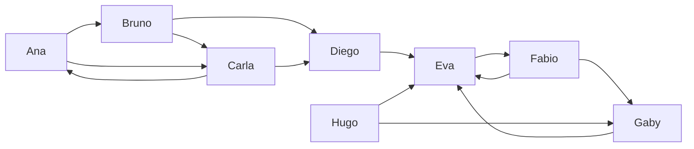

# Centralidad

Los algoritmos de centralidad puntúan cada nodo según qué tan importante es. "Importante" tiene varios sentidos, y cada algoritmo mide uno:

| Algoritmo | Un nodo puntúa alto cuando… |
| --- | --- |
| `algo.degree` | tiene muchas aristas |
| `algo.pageRank` | lo apuntan nodos a los que a su vez apuntan |
| `algo.eigenvector` | está unido a nodos de puntaje alto |
| `algo.hits` | apunta a buenas fuentes (hub) o lo apuntan buenos hubs (autoridad) |
| `algo.betweenness` | está en muchos caminos más cortos entre otros: un intermediario |
| `algo.closeness` | en promedio está cerca de todos los demás |
| `algo.harmonic` | está cerca de todos los demás, contando como cero a los inalcanzables |

Todos dan `node` y un puntaje, el más alto primero, y aceptan `top: n` para conservar solo los `n` mejores.

## Los datos de ejemplo

Dos grupos de personas que se siguen, unidos a través de Diego:



```text run title="Ejemplo"
CREATE (ana:Person {name: 'Ana'}), (bruno:Person {name: 'Bruno'}), (carla:Person {name: 'Carla'}),
       (diego:Person {name: 'Diego'}), (eva:Person {name: 'Eva'}), (fabio:Person {name: 'Fabio'}),
       (gaby:Person {name: 'Gaby'}), (hugo:Person {name: 'Hugo'}),
       (ana)-[:follows]->(bruno), (bruno)-[:follows]->(carla), (carla)-[:follows]->(ana),
       (ana)-[:follows]->(carla), (bruno)-[:follows]->(diego), (carla)-[:follows]->(diego),
       (diego)-[:follows]->(eva), (eva)-[:follows]->(fabio), (fabio)-[:follows]->(gaby),
       (gaby)-[:follows]->(eva), (fabio)-[:follows]->(eva), (hugo)-[:follows]->(eva),
       (hugo)-[:follows]->(gaby);
```

```text result title="Resultado"
8 nodes created, 13 edges created
```

## algo.degree

La cantidad de aristas de cada nodo (o la suma de sus pesos). `direction: 'in'` cuenta seguidores, `'out'` a quiénes sigue, `'both'` (por defecto) todas.

**Sintaxis:** `algo.degree({direction: 'both', weight, top, …})` da `node`, `score`.

```text run title="Ejemplo"
CALL algo.degree({direction: 'in'}) YIELD node, score
RETURN node.name, score AS followers LIMIT 4;
```

```text result title="Resultado"
 node.name | followers
-----------+-----------
 Eva       | 4.0
 Carla     | 2.0
 Diego     | 2.0
 Gaby      | 2.0
(4 rows)
```

**Úsalo para:** una primera mirada; las cuentas, productos o aeropuertos más conectados.

## algo.pageRank

Cada nodo pasa su puntaje por sus aristas; un nodo al que apuntan nodos de puntaje alto puntúa alto. Los puntajes suman 1.

**Sintaxis:** `algo.pageRank({damping: 0.85, iterations: 20, tolerance: 1e-7, sources, weight, top, …})` da `node`, `score`.

```text run title="Ejemplo"
CALL algo.pageRank() YIELD node, score
RETURN node.name, round(score, 3) AS score;
```

```text result title="Resultado"
 node.name | score
-----------+-------
 Eva       | 0.337
 Fabio     | 0.305
 Gaby      | 0.156
 Diego     | 0.056
 Carla     | 0.051
 Ana       | 0.041
 Bruno     | 0.036
 Hugo      | 0.019
(8 rows)
```

Eva va primero: Diego, Fabio, Gaby y Hugo le apuntan, y el puntaje del primer grupo le llega a través de Diego.

### PageRank personalizado

Con `sources`, cada salto aleatorio cae en esos nodos, así que los puntajes miden la importancia **desde su punto de vista**: ¿quién le importa a Ana?

```text run title="Ejemplo"
MATCH (a:Person {name: 'Ana'})
CALL algo.pageRank({sources: [a]}) YIELD node, score
RETURN node.name, round(score, 3) AS score LIMIT 4;
```

```text result title="Resultado"
 node.name | score
-----------+-------
 Eva       | 0.227
 Ana       | 0.202
 Fabio     | 0.193
 Carla     | 0.122
(4 rows)
```

**Úsalo para:** influencia en una red de seguidores, las páginas clave de un sitio, recomendaciones en torno a un usuario (personalizado).

## algo.eigenvector

El puntaje de un nodo es la suma de los puntajes de sus vecinos. Con `direction: 'in'` (por defecto), el puntaje viene de quienes apuntan al nodo.

**Sintaxis:** `algo.eigenvector({direction: 'in', iterations: 100, tolerance: 1e-6, weight, top, …})` da `node`, `score`.

```text run title="Ejemplo"
CALL algo.eigenvector({top: 4}) YIELD node, score
RETURN node.name, round(score, 3) AS score;
```

```text result title="Resultado"
 node.name | score
-----------+-------
 Eva       | 0.733
 Fabio     | 0.544
 Gaby      | 0.404
 Diego     | 0.038
(4 rows)
```

**Úsalo para:** estatus en una red donde los enlaces desde nodos importantes cuentan más; como PageRank sin los saltos aleatorios.

## algo.hits

Dos puntajes por nodo: **autoridad** (lo apuntan buenos hubs) y **hub** (apunta a buenas autoridades). Las filas vienen por autoridad.

**Sintaxis:** `algo.hits({iterations: 20, tolerance: 1e-8, weight, top, …})` da `node`, `hub`, `authority`.

```text run title="Ejemplo"
CALL algo.hits() YIELD node, hub, authority
RETURN node.name, round(hub, 3) AS hub, round(authority, 3) AS authority;
```

```text result title="Resultado"
 node.name | hub   | authority
-----------+-------+-----------
 Eva       | 0.0   | 0.851
 Gaby      | 0.372 | 0.526
 Carla     | 0.0   | 0.0
 Diego     | 0.372 | 0.0
 Ana       | 0.0   | 0.0
 Bruno     | 0.0   | 0.0
 Fabio     | 0.602 | 0.0
 Hugo      | 0.602 | 0.0
(8 rows)
```

**Úsalo para:** enlaces entre documentos o sitios, donde unos listan buenas fuentes (hubs) y otros son las fuentes (autoridades).

## algo.betweenness

Cuántos caminos más cortos entre otros nodos pasan por cada nodo. Los puntajes altos marcan **intermediarios**: sin ellos, los demás se separan.

**Sintaxis:** `algo.betweenness({direction: 'out', weight, sample, seed, top, …})` da `node`, `score`.

```text run title="Ejemplo"
CALL algo.betweenness({direction: 'both'}) YIELD node, score
RETURN node.name, round(score, 2) AS score LIMIT 4;
```

```text result title="Resultado"
 node.name | score
-----------+-------
 Eva       | 12.67
 Diego     | 12.0
 Carla     | 3.33
 Bruno     | 1.67
(4 rows)
```

Diego y Eva unen los dos grupos. En un grafo grande, `sample: 1000` estima los puntajes desde 1 000 nodos de partida en vez de todos.

**Úsalo para:** cuellos de botella de una red, personas que hacen de puente entre equipos, puntos únicos de falla.

## algo.closeness

Qué tan cerca está un nodo de todos los que alcanza: el inverso de la distancia promedio (Wasserman-Faust, ajustado para nodos que alcanzan solo parte del grafo).

**Sintaxis:** `algo.closeness({direction: 'out', harmonic: false, weight, top, …})` da `node`, `score`.

```text run title="Ejemplo"
CALL algo.closeness({direction: 'both'}) YIELD node, score
RETURN node.name, round(score, 3) AS score LIMIT 4;
```

```text result title="Resultado"
 node.name | score
-----------+-------
 Diego     | 0.636
 Eva       | 0.636
 Bruno     | 0.5
 Carla     | 0.5
(4 rows)
```

**Úsalo para:** dónde poner algo a lo que todos deben llegar rápido; quién puede difundir una noticia más rápido.

## algo.harmonic

La suma de `1 / distancia` a cada otro nodo. A diferencia de la cercanía, sigue teniendo sentido cuando hay nodos inalcanzables (suman 0).

**Sintaxis:** `algo.harmonic({direction: 'out', weight, top, …})` da `node`, `score`.

```text run title="Ejemplo"
CALL algo.harmonic({direction: 'both', top: 4}) YIELD node, score
RETURN node.name, round(score, 3) AS score;
```

```text result title="Resultado"
 node.name | score
-----------+-------
 Eva       | 0.762
 Diego     | 0.714
 Bruno     | 0.643
 Carla     | 0.643
(4 rows)
```

## Compararlos

Cada medida cuenta una historia distinta sobre las mismas personas:

```text run title="Ejemplo"
CALL algo.pageRank() YIELD node, score WITH node, score AS pagerank
CALL algo.betweenness({direction: 'both'}) YIELD node AS n2, score AS between
WITH node, pagerank, n2, between WHERE node = n2
CALL algo.degree({direction: 'in'}) YIELD node AS n3, score AS followers
WITH node, pagerank, between, n3, followers WHERE node = n3
RETURN node.name, followers, round(pagerank, 3) AS pagerank, round(between, 1) AS betweenness
ORDER BY pagerank DESC;
```

```text result title="Resultado"
 node.name | followers | pagerank | betweenness
-----------+-----------+----------+-------------
 Eva       | 4.0       | 0.337    | 12.7
 Fabio     | 1.0       | 0.305    | 0.0
 Gaby      | 2.0       | 0.156    | 0.3
 Diego     | 2.0       | 0.056    | 12.0
 Carla     | 2.0       | 0.051    | 3.3
 Ana       | 1.0       | 0.041    | 0.0
 Bruno     | 1.0       | 0.036    | 1.7
 Hugo      | 0.0       | 0.019    | 0.0
(8 rows)
```

:::tip Pesos
Con `weight`, el grado suma los pesos de las aristas, PageRank y el vector propio pasan más puntaje por las aristas más pesadas, y la intermediación, la cercanía y la armónica tratan el peso como una distancia.
:::
