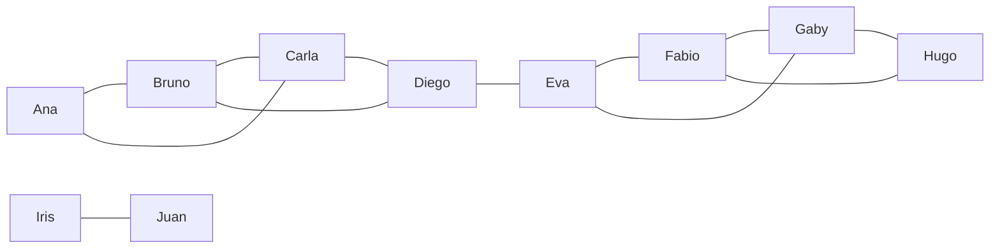

# Comunidades

Los algoritmos de comunidades dividen el grafo en grupos: partes que están conectadas, grupos densamente conectados por dentro, núcleos donde todos tienen muchos enlaces.

| Algoritmo | Encuentra |
| --- | --- |
| `algo.wcc` | componentes débilmente conectadas: partes unidas de alguna forma, sin importar la dirección |
| `algo.scc` | componentes fuertemente conectadas: partes donde todos llegan a todos siguiendo las flechas |
| `algo.labelPropagation` | grupos esparciendo etiquetas entre vecinos, rápido |
| `algo.louvain` | grupos que maximizan la modularidad (más aristas dentro de lo que daría el azar) |
| `algo.leiden` | los grupos de Louvain, cada uno garantizado conectado |
| `algo.kCore` | el número de núcleo de cada nodo: qué tan adentro de un núcleo denso está |
| `algo.triangles` | triángulos por nodo y el coeficiente de agrupamiento local |
| `algo.clustering` | la parte de los pares de vecinos de un nodo que están unidos |
| `algo.conductance` | qué tan cerrado es cada grupo: la parte de sus aristas que salen de él |

Los grupos se numeran desde 0 en el orden de los nodos.

## Los datos de ejemplo

Dos círculos de amigos unidos por Diego y Eva, y una pareja aparte:



```text run title="Ejemplo"
CREATE (ana:Person {name: 'Ana'}), (bruno:Person {name: 'Bruno'}), (carla:Person {name: 'Carla'}),
       (diego:Person {name: 'Diego'}), (eva:Person {name: 'Eva'}), (fabio:Person {name: 'Fabio'}),
       (gaby:Person {name: 'Gaby'}), (hugo:Person {name: 'Hugo'}), (iris:Person {name: 'Iris'}),
       (juan:Person {name: 'Juan'}),
       (ana)-[:knows]->(bruno), (ana)-[:knows]->(carla), (bruno)-[:knows]->(carla),
       (bruno)-[:knows]->(diego), (carla)-[:knows]->(diego), (diego)-[:knows]->(eva),
       (eva)-[:knows]->(fabio), (eva)-[:knows]->(gaby), (fabio)-[:knows]->(gaby),
       (fabio)-[:knows]->(hugo), (gaby)-[:knows]->(hugo), (iris)-[:knows]->(juan);
```

```text result title="Resultado"
10 nodes created, 12 edges created
```

## algo.wcc

Componentes débilmente conectadas: dos nodos están en la misma componente cuando los une alguna cadena de aristas, en cualquier dirección.

**Sintaxis:** `algo.wcc({…})` da `node`, `component`.

```text run title="Ejemplo"
CALL algo.wcc() YIELD node, component
RETURN component, collect(node.name) AS members ORDER BY component;
```

```text result title="Resultado"
 component | members
-----------+----------------------------------------------------
 0         | [Ana, Bruno, Carla, Diego, Eva, Fabio, Gaby, Hugo]
 1         | [Iris, Juan]
(2 rows)
```

**Úsalo para:** encontrar islas de datos, revisar que un grafo esté todo conectado, repartir trabajo por partes.

## algo.scc

Componentes fuertemente conectadas: todos en una componente llegan a todos los demás **siguiendo las flechas**.

**Sintaxis:** `algo.scc({…})` da `node`, `component`.

Llamadas entre servicios, donde algunos se llaman en ciclos:

```text run title="Ejemplo"
CREATE (a:Service {name: 'auth'}), (b:Service {name: 'billing'}), (c:Service {name: 'catalog'}),
       (d:Service {name: 'delivery'}), (e:Service {name: 'email'}),
       (a)-[:calls]->(b), (b)-[:calls]->(c), (c)-[:calls]->(a),
       (c)-[:calls]->(d), (d)-[:calls]->(e), (e)-[:calls]->(d);
CALL algo.scc({labels: 'Service'}) YIELD node, component
RETURN component, collect(node.name) AS members ORDER BY component;
```

```text result title="Resultado"
5 nodes created, 6 edges created
 component | members
-----------+--------------------------
 0         | [auth, billing, catalog]
 1         | [delivery, email]
(2 rows)
```

**Úsalo para:** ciclos de dependencias, grupos de páginas que se enlazan entre todas, ciclos de pagos.

## algo.labelPropagation

Cada nodo empieza con su propia etiqueta y toma una y otra vez la etiqueta más común entre sus vecinos, hasta que los grupos se asientan.

**Sintaxis:** `algo.labelPropagation({iterations: 10, seed, weight, …})` da `node`, `community`.

```text run title="Ejemplo"
CALL algo.labelPropagation({labels: 'Person'}) YIELD node, community
RETURN community, collect(node.name) AS members ORDER BY community;
```

```text result title="Resultado"
 community | members
-----------+----------------------------
 0         | [Ana, Bruno, Carla, Diego]
 1         | [Eva, Fabio, Gaby, Hugo]
 2         | [Iris, Juan]
(3 rows)
```

**Úsalo para:** un agrupamiento rápido de grafos muy grandes.

## algo.louvain

Mueve nodos entre grupos mientras crece la **modularidad**: una medida de cuántas más aristas caen dentro de los grupos de lo que daría el azar. También da la modularidad.

**Sintaxis:** `algo.louvain({resolution: 1, levels: 10, iterations: 10, weight, …})` da `node`, `community`, `modularity`.

```text run title="Ejemplo"
CALL algo.louvain({labels: 'Person'}) YIELD node, community, modularity
RETURN community, collect(node.name) AS members, round(max(modularity), 3) AS modularity
ORDER BY community;
```

```text result title="Resultado"
 community | members                    | modularity
-----------+----------------------------+------------
 0         | [Ana, Bruno, Carla, Diego] | 0.49
 1         | [Eva, Fabio, Gaby, Hugo]   | 0.49
 2         | [Iris, Juan]               | 0.49
(3 rows)
```

Una `resolution` más alta da grupos más chicos:

```text run title="Ejemplo"
CALL algo.louvain({labels: 'Person', resolution: 2.5}) YIELD node, community
RETURN community, collect(node.name) AS members ORDER BY community;
```

```text result title="Resultado"
 community | members
-----------+---------------------
 0         | [Ana, Bruno, Carla]
 1         | [Diego, Eva]
 2         | [Fabio, Gaby, Hugo]
 3         | [Iris, Juan]
(4 rows)
```

**Úsalo para:** comunidades en redes sociales, temas en un grafo de documentos, módulos de software.

## algo.leiden

Los grupos de Louvain, cada uno dividido en sus partes conectadas, así que ningún grupo queda desconectado por dentro. Mismas opciones que Louvain.

**Sintaxis:** `algo.leiden({resolution: 1, levels: 10, iterations: 10, weight, …})` da `node`, `community`, `modularity`.

```text run title="Ejemplo"
CALL algo.leiden({labels: 'Person'}) YIELD node, community
RETURN community, collect(node.name) AS members ORDER BY community;
```

```text result title="Resultado"
 community | members
-----------+----------------------------
 0         | [Ana, Bruno, Carla, Diego]
 1         | [Eva, Fabio, Gaby, Hugo]
 2         | [Iris, Juan]
(3 rows)
```

**Úsalo para:** las mismas preguntas que Louvain cuando los grupos deben estar conectados (por ejemplo, para resumir cada uno).

## algo.kCore

El **número de núcleo** de un nodo es el mayor `k` tal que el nodo pertenece a una parte del grafo donde cada nodo tiene al menos `k` vecinos en esa parte.

**Sintaxis:** `algo.kCore({…})` da `node`, `core`.

```text run title="Ejemplo"
CALL algo.kCore({labels: 'Person'}) YIELD node, core
RETURN core, collect(node.name) AS members ORDER BY core DESC;
```

```text result title="Resultado"
 core | members
------+----------------------------------------------------
 2    | [Ana, Bruno, Carla, Diego, Eva, Fabio, Gaby, Hugo]
 1    | [Iris, Juan]
(2 rows)
```

**Úsalo para:** el corazón denso de una red; quitar los nodos poco conectados antes de otros análisis.

## algo.triangles

En cuántos triángulos está cada nodo, y su coeficiente de agrupamiento local (la parte de sus pares de vecinos que están unidos).

**Sintaxis:** `algo.triangles({…})` da `node`, `triangles`, `coefficient`.

```text run title="Ejemplo"
CALL algo.triangles({labels: 'Person'}) YIELD node, triangles, coefficient
RETURN node.name, triangles, round(coefficient, 3) AS coefficient ORDER BY triangles DESC, node.name;
```

```text result title="Resultado"
 node.name | triangles | coefficient
-----------+-----------+-------------
 Bruno     | 2         | 0.667
 Carla     | 2         | 0.667
 Fabio     | 2         | 0.667
 Gaby      | 2         | 0.667
 Ana       | 1         | 1.0
 Diego     | 1         | 0.333
 Eva       | 1         | 0.333
 Hugo      | 1         | 1.0
 Iris      | 0         | 0.0
 Juan      | 0         | 0.0
(10 rows)
```

## algo.clustering

Solo el coeficiente de agrupamiento: 1 cuando todos los vecinos de un nodo se conocen entre sí, 0 cuando ninguno.

**Sintaxis:** `algo.clustering({…})` da `node`, `coefficient`.

```text run title="Ejemplo"
CALL algo.clustering({labels: 'Person'}) YIELD node, coefficient
RETURN node.name, round(coefficient, 3) AS coefficient ORDER BY coefficient, node.name;
```

```text result title="Resultado"
 node.name | coefficient
-----------+-------------
 Iris      | 0.0
 Juan      | 0.0
 Diego     | 0.333
 Eva       | 0.333
 Bruno     | 0.667
 Carla     | 0.667
 Fabio     | 0.667
 Gaby      | 0.667
 Ana       | 1.0
 Hugo      | 1.0
(10 rows)
```

Iris y Juan tienen un solo vecino cada uno, así que no tienen pares. Entre los demás, Diego y Eva tienen los coeficientes más bajos: sus vecinos están en círculos distintos.

**Úsalo para:** qué tan unido es un vecindario; detectar intermediarios (agrupamiento bajo, intermediación alta).

## algo.conductance

Para grupos dados por una propiedad entera (`community` por defecto): el peso de las aristas que salen del grupo sobre el peso de todas sus aristas. 0 es un grupo cerrado; cerca de 1, un grupo solo de nombre.

**Sintaxis:** `algo.conductance({property: 'community', …})` da `community`, `conductance`.

Guarda los grupos de Louvain y luego mídelos:

```text run title="Ejemplo"
CALL algo.louvain({labels: 'Person', write: 'community'});
CALL algo.conductance({labels: 'Person'}) YIELD community, conductance
RETURN community, round(conductance, 3) AS conductance ORDER BY community;
```

```text result title="Resultado"
 property  | column    | nodes
-----------+-----------+-------
 community | community | 10
(1 row)
10 properties set
 community | conductance
-----------+-------------
 0         | 0.091
 1         | 0.091
 2         | 0.0
(3 rows)
```

**Úsalo para:** revisar la calidad de los grupos, de cualquier algoritmo o de tus propios datos.

:::tip Direcciones
`wcc`, `labelPropagation`, `louvain`, `leiden`, `triangles`, `clustering` y `kCore` siguen las aristas en ambos sentidos: para ellos una amistad es una amistad, se haya escrito como se haya escrito. `scc` sigue las flechas.
:::
