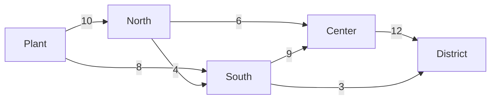

# Flujos y emparejamiento

Las aristas pueden ser cañerías, caminos o permisos: cada una lleva como máximo una **capacidad**, a veces con un **costo**. Estos algoritmos encuentran el mejor uso de ellas.

| Algoritmo | Responde |
| --- | --- |
| `algo.maxFlow(origen, sumidero)` | lo máximo que puede ir del origen al sumidero, y las aristas que lo limitan |
| `algo.minCostFlow()` | la forma más barata de enviar la oferta de cada nodo a los nodos que la necesitan |
| `algo.bipartiteMatching()` | el máximo de parejas entre dos tipos de nodos |
| `algo.assignment()` | cada agente a una tarea, al menor costo total |

## algo.maxFlow

El mayor flujo de `origen` a `sumidero` en la dirección de las aristas, cada arista llevando como máximo su `weight`. Una fila por arista que lleva flujo; `value` es el total, y `cut` marca las aristas de un **corte mínimo**: el cuello de botella.

**Sintaxis:** `algo.maxFlow(origen, sumidero, {weight: capacidad, …})` da `edge`, `flow`, `value`, `cut`.

Matrices de agua desde una planta hasta un barrio, con capacidades en litros por segundo:



```text run title="Ejemplo"
CREATE (plant:Node {name: 'Plant'}), (north:Node {name: 'North'}), (south:Node {name: 'South'}),
       (center:Node {name: 'Center'}), (district:Node {name: 'District'}),
       (plant)-[:main {capacity: 10}]->(north), (plant)-[:main {capacity: 8}]->(south),
       (north)-[:main {capacity: 4}]->(south), (north)-[:main {capacity: 6}]->(center),
       (south)-[:main {capacity: 9}]->(center), (center)-[:main {capacity: 12}]->(district),
       (south)-[:main {capacity: 3}]->(district);
MATCH (s:Node {name: 'Plant'}), (t:Node {name: 'District'})
CALL algo.maxFlow(s, t, {weight: 'capacity'}) YIELD edge, flow, value, cut
MATCH (a)-[edge]->(b)
RETURN a.name, b.name, flow, edge.capacity AS capacity, cut, value
ORDER BY a.name, b.name;
```

```text result title="Resultado"
5 nodes created, 7 edges created
 a.name | b.name   | flow | capacity | cut   | value
--------+----------+------+----------+-------+-------
 Center | District | 12.0 | 12       | true  | 15.0
 North  | Center   | 6.0  | 6        | false | 15.0
 North  | South    | 1.0  | 4        | false | 15.0
 Plant  | North    | 7.0  | 10       | false | 15.0
 Plant  | South    | 8.0  | 8        | false | 15.0
 South  | Center   | 6.0  | 9        | false | 15.0
 South  | District | 3.0  | 3        | true  | 15.0
(7 rows)
```

Al barrio llegan como máximo 15 litros por segundo. Las aristas del corte, Center a District y South a District, van llenas: ensanchar otra matriz no ayudaría.

**Úsalo para:** capacidad de una red, rutas de evacuación, el cuello de botella de una cadena de suministro, cuántos caminos independientes unen dos nodos (capacidad 1 cada uno).

## algo.minCostFlow

Los nodos **ofrecen** (una propiedad mayor que 0) o **necesitan** (menor que 0) cantidades. Las aristas llevan como máximo su propiedad `capacity` a `cost` por unidad. El algoritmo envía todo al menor costo total; `unmet` es la oferta que ninguna ruta pudo llevar.

**Sintaxis:** `algo.minCostFlow({supply: propiedad, capacity: propiedad, cost: propiedad, …})` da `edge`, `flow`, `value`, `cost`, `unmet`. Las tres opciones nombran las propiedades y son obligatorias.

Dos bodegas abastecen a tres tiendas:

```text run title="Ejemplo"
CREATE (w1:Site {name: 'Warehouse A', supply: 30}), (w2:Site {name: 'Warehouse B', supply: 20}),
       (s1:Site {name: 'Store 1', supply: -15}), (s2:Site {name: 'Store 2', supply: -20}),
       (s3:Site {name: 'Store 3', supply: -15}),
       (w1)-[:route {capacity: 20, cost: 4}]->(s1), (w1)-[:route {capacity: 20, cost: 6}]->(s2),
       (w1)-[:route {capacity: 20, cost: 9}]->(s3), (w2)-[:route {capacity: 20, cost: 7}]->(s1),
       (w2)-[:route {capacity: 20, cost: 3}]->(s2), (w2)-[:route {capacity: 20, cost: 5}]->(s3);
CALL algo.minCostFlow({labels: 'Site', supply: 'supply', capacity: 'capacity', cost: 'cost'}) YIELD edge, flow, value, cost, unmet
MATCH (a)-[edge]->(b)
RETURN a.name, b.name, flow, edge.cost AS unit_cost, cost AS total_cost, unmet
ORDER BY a.name, b.name;
```

```text result title="Resultado"
5 nodes created, 6 edges created
 a.name      | b.name  | flow | unit_cost | total_cost | unmet
-------------+---------+------+-----------+------------+-------
 Warehouse A | Store 1 | 15.0 | 4         | 240.0      | 0.0
 Warehouse A | Store 2 | 15.0 | 6         | 240.0      | 0.0
 Warehouse B | Store 2 | 5.0  | 3         | 240.0      | 0.0
 Warehouse B | Store 3 | 15.0 | 5         | 240.0      | 0.0
(4 rows)
```

Cada tienda recibe lo que necesita por 240 en total. Los 20 de la bodega B van donde es más barato (Store 3, y 5 a Store 2 a 3 cada uno); la bodega A cubre el resto.

**Úsalo para:** distribución y logística, mover personal o existencias entre lugares, cualquier problema de transporte.

## algo.bipartiteMatching

Dos tipos de nodos, y aristas entre ellos que dicen quién puede formar pareja con quién. El algoritmo encuentra el máximo de parejas, cada nodo en a lo más una. Los nodos con la etiqueta `left` son un lado; el resto, el otro.

**Sintaxis:** `algo.bipartiteMatching({left: etiqueta, …})` da `left`, `right`, `edge`.

Mentores y los estudiantes que cada uno puede guiar:

```text run title="Ejemplo"
CREATE (m1:Mentor {name: 'Ana'}), (m2:Mentor {name: 'Bruno'}), (m3:Mentor {name: 'Carla'}),
       (s1:Student {name: 'Diego'}), (s2:Student {name: 'Eva'}), (s3:Student {name: 'Fabio'}),
       (m1)-[:can_mentor]->(s1), (m1)-[:can_mentor]->(s2),
       (m2)-[:can_mentor]->(s1),
       (m3)-[:can_mentor]->(s2), (m3)-[:can_mentor]->(s3);
CALL algo.bipartiteMatching({labels: ['Mentor', 'Student'], left: 'Mentor'}) YIELD left, right
RETURN left.name AS mentor, right.name AS student ORDER BY mentor;
```

```text result title="Resultado"
6 nodes created, 5 edges created
 mentor | student
--------+---------
 Ana    | Eva
 Bruno  | Diego
 Carla  | Fabio
(3 rows)
```

Bruno solo puede tomar a Diego, así que Ana toma a Eva y Carla a Fabio: todos quedan emparejados.

**Úsalo para:** emparejar personas con roles, salas con eventos, trabajos con máquinas, cuando cualquier pareja permitida vale lo mismo.

## algo.assignment

Cada agente (etiqueta `agents`) a una tarea (etiqueta `tasks`), donde una arista entre ellos está permitida y su `weight` es el costo; el costo total es el menor posible.

**Sintaxis:** `algo.assignment({agents: etiqueta, tasks: etiqueta, weight: costo, …})` da `agent`, `task`, `cost`.

Tres conductores, tres entregas, los minutos que necesita cada conductor:

```text run title="Ejemplo"
CREATE (d1:Driver {name: 'Ana'}), (d2:Driver {name: 'Bruno'}), (d3:Driver {name: 'Carla'}),
       (j1:Delivery {name: 'Airport'}), (j2:Delivery {name: 'Harbor'}), (j3:Delivery {name: 'Downtown'}),
       (d1)-[:can_do {minutes: 30}]->(j1), (d1)-[:can_do {minutes: 25}]->(j2), (d1)-[:can_do {minutes: 10}]->(j3),
       (d2)-[:can_do {minutes: 20}]->(j1), (d2)-[:can_do {minutes: 40}]->(j2), (d2)-[:can_do {minutes: 15}]->(j3),
       (d3)-[:can_do {minutes: 35}]->(j1), (d3)-[:can_do {minutes: 20}]->(j2), (d3)-[:can_do {minutes: 30}]->(j3);
CALL algo.assignment({labels: ['Driver', 'Delivery'], agents: 'Driver', tasks: 'Delivery', weight: 'minutes'})
YIELD agent, task, cost
RETURN agent.name, task.name, cost ORDER BY agent.name;
```

```text result title="Resultado"
6 nodes created, 9 edges created
 agent.name | task.name | cost
------------+-----------+------
 Ana        | Downtown  | 10.0
 Bruno      | Airport   | 20.0
 Carla      | Harbor    | 20.0
(3 rows)
```

Ana toma Downtown aunque Bruno también es rápido ahí: Bruno es el mejor para Airport, y el total, 50 minutos, es el menor de los seis planes posibles.

**Úsalo para:** personal a turnos, vehículos a pedidos, revisores a artículos, cualquier plan uno a uno con costos.
