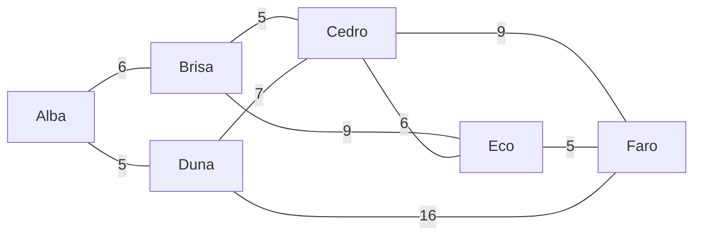

# Algoritmos de caminos

Encuentra rutas por el grafo ponderadas por una propiedad: kilómetros, minutos, costo, riesgo.

| Algoritmo | Responde |
| --- | --- |
| `algo.shortestPath(a, b)` | la ruta más barata de `a` a `b` (Dijkstra) |
| `algo.astar(a, b)` | lo mismo, más rápido en mapas, guiado por coordenadas (A*) |
| `algo.kShortestPaths(a, b, k)` | las `k` rutas más baratas, la más barata primero |
| `algo.allShortestPaths(a, b)` | todas las rutas empatadas como más baratas |
| `algo.distances(a)` | el costo desde `a` hasta cada lugar al que llega |

## Los datos de ejemplo

Seis pueblos en un mapa (coordenadas en km) y los caminos entre ellos, con su largo en km. Los caminos van en ambos sentidos, así que las llamadas dicen `direction: 'both'`:



```text run title="Ejemplo"
CREATE (alba:Town {name: 'Alba', x: 0, y: 0}), (brisa:Town {name: 'Brisa', x: 4, y: 3}),
       (cedro:Town {name: 'Cedro', x: 8, y: 0}), (duna:Town {name: 'Duna', x: 4, y: -3}),
       (eco:Town {name: 'Eco', x: 12, y: 3}), (faro:Town {name: 'Faro', x: 16, y: 0}),
       (alba)-[:road {km: 6}]->(brisa), (alba)-[:road {km: 5}]->(duna),
       (brisa)-[:road {km: 5}]->(cedro), (duna)-[:road {km: 7}]->(cedro),
       (brisa)-[:road {km: 9}]->(eco), (cedro)-[:road {km: 6}]->(eco),
       (cedro)-[:road {km: 9}]->(faro), (eco)-[:road {km: 5}]->(faro),
       (duna)-[:road {km: 16}]->(faro);
```

```text result title="Resultado"
6 nodes created, 9 edges created
```

## algo.shortestPath

La ruta más barata según `weight`. Sin `weight`, la ruta con menos aristas.

**Sintaxis:** `algo.shortestPath(origen, destino, {weight, direction: 'out', …})` da `nodes`, `edges`, `cost`.

```text run title="Ejemplo"
MATCH (a:Town {name: 'Alba'}), (b:Town {name: 'Faro'})
CALL algo.shortestPath(a, b, {weight: 'km', direction: 'both'}) YIELD nodes, cost
RETURN [t IN nodes | t.name] AS route, cost;
```

```text result title="Resultado"
 route                      | cost
----------------------------+------
 [Alba, Brisa, Cedro, Faro] | 20.0
(1 row)
```

Los menos caminos, sin importar el largo:

```text run title="Ejemplo"
MATCH (a:Town {name: 'Alba'}), (b:Town {name: 'Faro'})
CALL algo.shortestPath(a, b, {direction: 'both'}) YIELD nodes, cost
RETURN [t IN nodes | t.name] AS route, cost AS roads;
```

```text result title="Resultado"
 route              | roads
--------------------+-------
 [Alba, Duna, Faro] | 2.0
(1 row)
```

**Úsalo para:** rutas en un mapa, la cadena de transbordos más barata, la cadena de presentaciones más corta entre dos personas.

## algo.astar

La misma respuesta que `shortestPath`, encontrada mirando primero hacia el destino con las coordenadas de los nodos: `x` e `y` (distancia en línea recta), o `latitude` y `longitude` (km sobre la Tierra). Los pesos nunca deben ser más cortos que la línea recta, o A* puede perder la mejor ruta.

**Sintaxis:** `algo.astar(origen, destino, {weight, x: 'x', y: 'y' | latitude, longitude, …})` da `nodes`, `edges`, `cost`.

```text run title="Ejemplo"
MATCH (a:Town {name: 'Alba'}), (b:Town {name: 'Faro'})
CALL algo.astar(a, b, {weight: 'km', x: 'x', y: 'y', direction: 'both'}) YIELD nodes, cost
RETURN [t IN nodes | t.name] AS route, cost;
```

```text result title="Resultado"
 route                      | cost
----------------------------+------
 [Alba, Brisa, Cedro, Faro] | 20.0
(1 row)
```

**Úsalo para:** mapas grandes de caminos o cuadrículas, donde mirar hacia la meta ahorra la mayor parte de la búsqueda.

## algo.kShortestPaths

Las `k` rutas más baratas sin ciclos (algoritmo de Yen), la más barata primero.

**Sintaxis:** `algo.kShortestPaths(origen, destino, k, {weight, …})` da `rank`, `nodes`, `edges`, `cost`.

```text run title="Ejemplo"
MATCH (a:Town {name: 'Alba'}), (b:Town {name: 'Faro'})
CALL algo.kShortestPaths(a, b, 4, {weight: 'km', direction: 'both'}) YIELD rank, nodes, cost
RETURN rank, [t IN nodes | t.name] AS route, cost;
```

```text result title="Resultado"
 rank | route                      | cost
------+----------------------------+------
 1    | [Alba, Brisa, Cedro, Faro] | 20.0
 2    | [Alba, Brisa, Eco, Faro]   | 20.0
 3    | [Alba, Duna, Faro]         | 21.0
 4    | [Alba, Duna, Cedro, Faro]  | 21.0
(4 rows)
```

**Úsalo para:** alternativas cuando la mejor ruta está cerrada, o para ofrecer opciones.

## algo.allShortestPaths

Todas las rutas cuyo costo empata con la más barata, como máximo `limit` (100).

**Sintaxis:** `algo.allShortestPaths(origen, destino, {weight, limit: 100, …})` da `nodes`, `edges`, `cost`.

```text run title="Ejemplo"
MATCH (a:Town {name: 'Alba'}), (b:Town {name: 'Faro'})
CALL algo.allShortestPaths(a, b, {weight: 'km', direction: 'both'}) YIELD nodes, cost
RETURN [t IN nodes | t.name] AS route, cost;
```

```text result title="Resultado"
 route                      | cost
----------------------------+------
 [Alba, Brisa, Cedro, Faro] | 20.0
 [Alba, Brisa, Eco, Faro]   | 20.0
(2 rows)
```

**Úsalo para:** ver si la mejor ruta es única, o repartir carga entre rutas equivalentes.

## algo.distances

El costo desde un nodo hasta cada nodo al que llega, el más cercano primero.

**Sintaxis:** `algo.distances(origen, {weight, …})` da `node`, `cost`.

```text run title="Ejemplo"
MATCH (a:Town {name: 'Alba'})
CALL algo.distances(a, {weight: 'km', direction: 'both'}) YIELD node, cost
RETURN node.name, cost;
```

```text result title="Resultado"
 node.name | cost
-----------+------
 Alba      | 0.0
 Duna      | 5.0
 Brisa     | 6.0
 Cedro     | 11.0
 Eco       | 15.0
 Faro      | 20.0
(6 rows)
```

Combínalo con un filtro: los pueblos a 12 km o menos de Alba:

```text run title="Ejemplo"
MATCH (a:Town {name: 'Alba'})
CALL algo.distances(a, {weight: 'km', direction: 'both'}) YIELD node, cost
WHERE cost <= 12 AND node <> a
RETURN node.name, cost;
```

```text result title="Resultado"
 node.name | cost
-----------+------
 Duna      | 5.0
 Brisa     | 6.0
 Cedro     | 11.0
(3 rows)
```

**Úsalo para:** áreas de servicio, "todo lo que está a 30 minutos", el más cercano de muchos lugares (o usa [algo.distanceField](simulation.md#algodistancefield) desde varios orígenes a la vez).

:::tip Saltos, no pesos
Para la menor cantidad de saltos en aristas sin peso, el patrón GQ `shortestPath((a)-[*]-(b))` también sirve, ver [Caminos](../gq/paths.md).
:::
