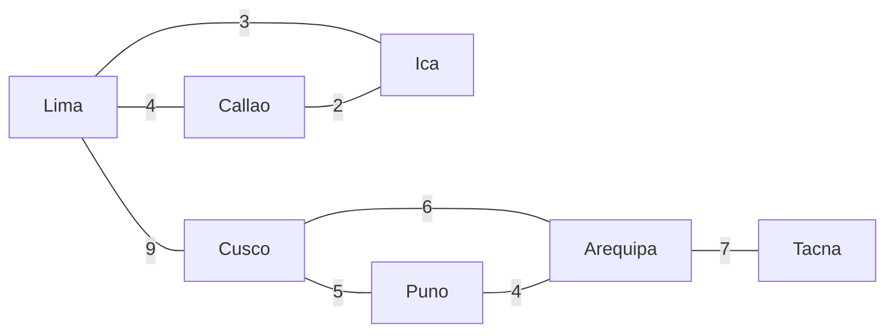

# Estructura

Estos algoritmos miran el esqueleto del grafo: qué lo mantiene unido, cómo conectarlo al menor costo y en qué orden pueden ir sus partes.

| Algoritmo | Encuentra |
| --- | --- |
| `algo.articulationPoints` | nodos cuya eliminación divide su parte del grafo |
| `algo.bridges` | aristas cuya eliminación divide su parte del grafo |
| `algo.spanningTree` | el conjunto de aristas más barato que mantiene conectados todos los nodos |
| `algo.topologicalOrder` | un orden en que cada arista apunta hacia adelante |
| `algo.cycle` | un ciclo, si hay alguno |

## Los datos de ejemplo

Oficinas unidas por enlaces de red, con el costo de cada enlace:



```text run title="Ejemplo"
CREATE (lima:Office {name: 'Lima'}), (callao:Office {name: 'Callao'}), (ica:Office {name: 'Ica'}),
       (cusco:Office {name: 'Cusco'}), (puno:Office {name: 'Puno'}), (arequipa:Office {name: 'Arequipa'}),
       (tacna:Office {name: 'Tacna'}),
       (lima)-[:link {cost: 4}]->(callao), (lima)-[:link {cost: 3}]->(ica), (callao)-[:link {cost: 2}]->(ica),
       (lima)-[:link {cost: 9}]->(cusco), (cusco)-[:link {cost: 5}]->(puno),
       (cusco)-[:link {cost: 6}]->(arequipa), (puno)-[:link {cost: 4}]->(arequipa),
       (arequipa)-[:link {cost: 7}]->(tacna);
```

```text result title="Resultado"
7 nodes created, 8 edges created
```

## algo.articulationPoints

Nodos que, si fallaran, cortarían en dos su parte del grafo. Las aristas cuentan en ambos sentidos.

**Sintaxis:** `algo.articulationPoints({…})` da `node`.

```text run title="Ejemplo"
CALL algo.articulationPoints({labels: 'Office'}) YIELD node RETURN node.name ORDER BY node.name;
```

```text result title="Resultado"
 node.name
-----------
 Arequipa
 Cusco
 Lima
(3 rows)
```

Lima une la costa con el sur; Cusco une Lima con el sur; Arequipa es la única entrada a Tacna.

**Úsalo para:** puntos únicos de falla en redes, cadenas de suministro, organizaciones.

## algo.bridges

Aristas que, si se cortaran, dividirían su parte del grafo.

**Sintaxis:** `algo.bridges({…})` da `edge`.

```text run title="Ejemplo"
CALL algo.bridges({labels: 'Office'}) YIELD edge
MATCH (a)-[edge]->(b)
RETURN a.name, b.name, edge.cost;
```

```text result title="Resultado"
 a.name   | b.name | edge.cost
----------+--------+-----------
 Lima     | Cusco  | 9
 Arequipa | Tacna  | 7
(2 rows)
```

Los demás enlaces están cada uno en un ciclo, así que si se corta uno queda otro camino.

**Úsalo para:** enlaces que conviene duplicar; los lazos débiles entre comunidades.

## algo.spanningTree

Un bosque generador mínimo: las aristas de menor `weight` total que mantienen alcanzables todos los nodos (un árbol por parte conectada). `maximum: true` toma las más pesadas.

**Sintaxis:** `algo.spanningTree({weight, maximum: false, …})` da `edge`, `weight`.

```text run title="Ejemplo"
CALL algo.spanningTree({labels: 'Office', weight: 'cost'}) YIELD edge, weight
MATCH (a)-[edge]->(b)
RETURN a.name, b.name, weight ORDER BY weight;
```

```text result title="Resultado"
 a.name   | b.name   | weight
----------+----------+--------
 Callao   | Ica      | 2.0
 Lima     | Ica      | 3.0
 Puno     | Arequipa | 4.0
 Cusco    | Puno     | 5.0
 Arequipa | Tacna    | 7.0
 Lima     | Cusco    | 9.0
(6 rows)
```

```text run title="Ejemplo"
CALL algo.spanningTree({labels: 'Office', weight: 'cost'}) YIELD weight
RETURN count(*) AS links, sum(weight) AS total_cost;
```

```text result title="Resultado"
 links | total_cost
-------+------------
 6     | 30.0
(1 row)
```

Seis enlaces que cuestan 30 en total conectan las siete oficinas; la red completa tiene ocho enlaces que cuestan 40.

**Úsalo para:** el cableado, las cañerías o los caminos más baratos que conectan todo; una columna vertebral para dibujar un grafo grande.

## algo.topologicalOrder

Un orden de los nodos en que cada arista va de un nodo anterior a uno posterior: un orden para hacer tareas que dependen unas de otras. Un ciclo lo hace imposible, y la consulta falla nombrando el ciclo.

**Sintaxis:** `algo.topologicalOrder({…})` da `node`, `position`.

Pasos de una compilación, cada uno apuntando a los pasos que lo necesitan:

```text run title="Ejemplo"
CREATE (fetch:Task {name: 'fetch'}), (compile:Task {name: 'compile'}), (test:Task {name: 'test'}),
       (docs:Task {name: 'docs'}), (package:Task {name: 'package'}), (release:Task {name: 'release'}),
       (fetch)-[:before]->(compile), (compile)-[:before]->(test), (compile)-[:before]->(docs),
       (test)-[:before]->(package), (docs)-[:before]->(package), (package)-[:before]->(release);
CALL algo.topologicalOrder({labels: 'Task'}) YIELD node, position
RETURN position, node.name;
```

```text result title="Resultado"
6 nodes created, 6 edges created
 position | node.name
----------+-----------
 0        | fetch
 1        | compile
 2        | test
 3        | docs
 4        | package
 5        | release
(6 rows)
```

**Úsalo para:** planificadores de compilación y de trabajos, prerrequisitos de cursos, migraciones en orden.

## algo.cycle

Un ciclo en el orden de sus nodos, o ninguna fila cuando no hay.

**Sintaxis:** `algo.cycle({…})` da `nodes`.

```text run title="Ejemplo"
CALL algo.cycle({labels: 'Task'}) YIELD nodes RETURN [n IN nodes | n.name] AS cycle;
```

```text result title="Resultado"
 cycle
-------
(0 rows)
```

Todavía no hay. Agrega un paso que vuelve atrás:

```text run title="Ejemplo"
MATCH (r:Task {name: 'release'}), (c:Task {name: 'compile'}) CREATE (r)-[:before]->(c);
CALL algo.cycle({labels: 'Task'}) YIELD nodes RETURN [n IN nodes | n.name] AS cycle;
```

```text result title="Resultado"
1 edge created
 cycle
-----------------------------------
 [test, package, release, compile]
(1 row)
```

Ahora el orden no puede existir:

```text run title="Ejemplo"
CALL algo.topologicalOrder({labels: 'Task'}) YIELD node, position RETURN count(*);
```

```text result title="Resultado"
error: the edges make a cycle, so there is no topological order: 01a1cb1f-4752-757f-bba7-a193aae405aa → 01a1cb1f-4752-7581-b606-9cf8b4a13ee9 → 01a1cb1f-4752-7582-ae7b-098400dc3bdc → 01a1cb1f-4752-757e-ad42-ee3ebff97f36
```

**Úsalo para:** encontrar dependencias circulares, ciclos de pagos, bloqueos mutuos.
