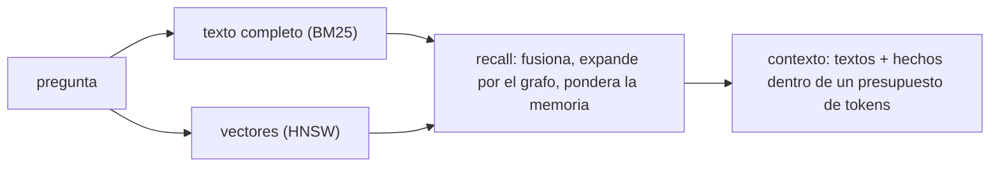

# Búsqueda y recall

Un agente hace una pregunta; necesita las pocas cosas de la memoria que importan, lo bastante breves para caber en la ventana del modelo, y citables. Grafeno responde en cuatro capas, cada una sobre la anterior.



## Búsqueda de texto completo

El texto que pones en `@text` queda indexado. La búsqueda ordena con BM25, la puntuación clásica de relevancia de los buscadores:

```text
CALL db.search('telemetry', 5) YIELD node, score RETURN node.title, score;
```

En la consola: `\search telemetry`. Por HTTP: `POST /v1/{namespace}/search/text` con `{"query": "telemetry", "limit": 5}`.

### El idioma del namespace

Las palabras coinciden enteras, sin importar acentos ni mayúsculas. Si le dices a un namespace en qué idioma están sus textos, las palabras se reducen a su raíz, también los verbos: «decidimos» encuentra «decidir», «revisiones» encuentra «revisión», «graphs» encuentra «graph».

```bash
curl -X PATCH http://127.0.0.1:7810/v1/namespaces/notas \
  -H "Authorization: Bearer $TOKEN" -H 'content-type: application/json' \
  -d '{"language": "es"}'
```

`es` (español) y `en` (inglés); `null` vuelve a las palabras enteras. También puede darse al crear el namespace (`POST /v1/namespaces` con `{"name": "notas", "language": "es"}`). Fijarlo o cambiarlo vuelve a indexar al momento los textos del namespace. Se aplica a los textos de los nodos (`@text`), es decir, a la búsqueda y al recall; un [índice de texto completo](../gq/full-text.md) conserva el analizador con el que se creó.

## Búsqueda vectorial

La búsqueda de texto encuentra palabras; la vectorial encuentra *significado*. Dale a un nodo un embedding — una lista de números que produjo tu modelo de embeddings — y Grafeno encuentra los más cercanos:

```text
CREATE (:Doc {title: 'cats', @embedding: [1.0, 0.0, 0.0]}),
       (:Doc {title: 'dogs', @embedding: [0.9, 0.1, 0.0]}),
       (:Doc {title: 'cars', @embedding: [0.0, 0.0, 1.0]});

CALL db.searchVector([1.0, 0.05, 0.0], 2) YIELD node, score RETURN node.title, score;
```

```text
 node.title | score
------------+--------------------
 cats       | 0.9987523555755615
 dogs       | 0.9981583952903748
(2 rows)
```

:::info Grafeno no llama a ningún modelo
Grafeno guarda y busca embeddings; nunca los calcula. Tu aplicación (o tu agente) llama al modelo de embeddings que elija y envía los vectores. Los embeddings reales tienen cientos de dimensiones; todos los nodos de un namespace deben usar la misma.
:::

El índice es HNSW con copias int8 compactas y reordenamiento exacto: con 20 000 vectores agrupados encuentra el 99,6 % de los diez más cercanos verdaderos en unos 0,4 ms, y sigue preciso mientras los vectores se agregan, cambian y borran.

## Recall

El recall combina ambas búsquedas y el grafo. Ordena por texto y por significado, fusiona las listas, sigue los hechos desde los mejores resultados hacia nodos relacionados, y pondera lo que sabe la memoria: qué tan importante es un nodo (`@importance`, de 0 a 1) y qué tan reciente fue su uso.

```bash
curl -X POST http://127.0.0.1:7810/v1/demo/recall \
  -H "Authorization: Bearer $TOKEN" -H 'content-type: application/json' \
  -d '{"text": "who leads robotics?", "limit": 3}'
```

Cada resultado dice por qué se encontró, en `signals`:

```json
[{"node": {"labels": ["Person"], "props": {"name": "Ana Torres"}, "…": "…"},
  "score": 0.0254,
  "signals": [{"kind": "text", "rank": 1, "score": 0.575},
              {"kind": "memory", "importance": 0.5, "recency": 0.99}]}]
```

Envía también `embedding` con el vector de la pregunta, y el recall usa significado además de palabras. En la consola: `\recall who leads robotics?`.

Un recuerdo que solo una de las dos búsquedas encuentra sigue saliendo arriba si esa búsqueda lo pone arriba: una pregunta en español sobre un recuerdo escrito en inglés no comparte palabras con él, y su significado basta. `labels` deja los resultados en algunos tipos de nodo, y el recall también busca entre ellos, así que pedir `["Decision"]` encuentra una decisión antigua aunque haya miles de conversaciones sobre el mismo tema.

### Recuerdos reemplazados

Cuando un recuerdo más nuevo reemplaza a uno anterior (un hecho `supersedes` del nuevo al viejo, todavía vigente), el viejo baja de posición, sin importar quién grabó cada uno, y lo dice en sus señales (`{"kind": "superseded", "by": [...]}`). `superseded_weight` es el factor por el que se multiplica su puntuación: 0,2 por defecto, 1 para ordenarlo como cualquier otro. El contexto ordena sus recuerdos del mismo modo.

### Seguir el grafo

Desde las mejores coincidencias (`seeds`, 5), el recall sigue los hechos `depth` saltos (1) y le pasa a cada nodo alcanzado una parte del puntaje de la semilla: la mitad por salto (`decay`), y menos a través de nodos con muchas aristas. Un nodo conectado con casi todo (el usuario, el proyecto actual, una etiqueta común) sumaría puntaje de cada coincidencia y aparecería en todas las respuestas; el recall divide la parte que pasa por una arista entre `sqrt((1 + hubs × ln d₁)(1 + hubs × ln d₂))`, donde d₁ y d₂ son las aristas de sus dos extremos, y sigue como máximo `fanout` vecinos (100) desde cada nodo, primero los que encontró la búsqueda. Todo va en `expand`:

```bash
curl -X POST http://127.0.0.1:7810/v1/demo/recall \
  -H "Authorization: Bearer $TOKEN" -H 'content-type: application/json' \
  -d '{"text": "what did the platform team decide?", "expand": {"depth": 3, "hubs": 1, "fanout": 100}}'
```

Un nodo al que llega el grafo sube hasta justo debajo del recuerdo que lo trajo, nunca por encima: el recuerdo con el que coincide la pregunta va primero, y aquello a lo que lleva, justo después. `"expand": false` lo desactiva; `"hubs": 0` y `"fanout": 0` dan la expansión sin atenuar de los motores anteriores. El repositorio del motor tiene un ejemplo en el que la respuesta solo vuelve a través del grafo (una decisión a tres saltos de la persona por la que se pregunta, cuyo texto no nombra ni a la persona ni al equipo), con lo que encuentra la búsqueda de texto sola y lo que le hacen los hubs sin atenuar: `cargo run -p grafeno-memory --example multi_hop`.

## Contexto {#context}

El contexto es lo que le das al modelo: los textos recuperados más los hechos que los rodean, escritos como oraciones simples, recortados a un presupuesto de tokens.

```bash
curl -X POST http://127.0.0.1:7810/v1/demo/context \
  -H "Authorization: Bearer $TOKEN" -H 'content-type: application/json' \
  -d '{"text": "who leads robotics?", "budget": 300}'
```

```json
{"items": [{"name": "Ana Torres", "labels": ["Person"], "text": "Ana leads the robotics team at Acme.", "…": "…"}],
 "facts": [{"label": "works_at", "text": "Ana Torres works_at Acme Robotics (from 2021-03-01)", "…": "…"}],
 "tokens": 66,
 "rendered": "## Memory\n[1] Ana Torres (Person)\nAna leads the robotics team at Acme.\n…"}
```

Sin un tokenizador, el motor cuenta los tokens del lado seguro: un token por cada cuatro letras ASCII, tres dígitos, o cualquier otro carácter (puntuación, símbolos, letras con tilde, otras escrituras), así el código, los datos y el texto que no está en inglés no se pasan del presupuesto. `rendered` está listo para pegar en un prompt; `items` y `facts` conservan los ids, así la respuesta del modelo puede citarlos. Opciones: `fact_share` (qué parte del presupuesto va a hechos), `max_facts` y `communities` para agregar resúmenes de las [comunidades](../guides/agent-memory.md#summaries-of-what-belongs-together) que coincidan.

## Por MCP

Los agentes conectados por [MCP](../guides/mcp.md) tienen lo mismo como herramientas: `recall` y `context`.
