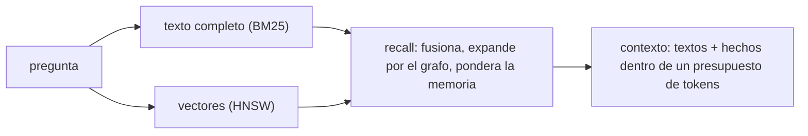

# Búsqueda y recall

Un agente hace una pregunta; necesita las pocas cosas de la memoria que importan, lo bastante breves para caber en la ventana del modelo, y citables. Grafeno responde en cuatro capas, cada una sobre la anterior.



## Búsqueda de texto completo

El texto que pones en `@text` queda indexado. La búsqueda ordena con BM25, la puntuación clásica de relevancia de los buscadores:

```text
CALL db.search('telemetry', 5) YIELD node, score RETURN node.title, score;
```

En la consola: `\search telemetry`. Por HTTP: `POST /v1/{namespace}/search/text` con `{"query": "telemetry", "limit": 5}`.

## Búsqueda vectorial

La búsqueda de texto encuentra palabras; la vectorial encuentra *significado*. Dale a un nodo un embedding — una lista de números que produjo tu modelo de embeddings — y Grafeno encuentra los más cercanos:

```text
CREATE (:Doc {title: 'cats', @embedding: [1.0, 0.0, 0.0]}),
       (:Doc {title: 'dogs', @embedding: [0.9, 0.1, 0.0]}),
       (:Doc {title: 'cars', @embedding: [0.0, 0.0, 1.0]});

CALL db.searchVector([1.0, 0.05, 0.0], 2) YIELD node, score RETURN node.title, score;
```

```text
 node.title | score
------------+--------------------
 cats       | 0.9987523555755615
 dogs       | 0.9981583952903748
(2 rows)
```

:::info Grafeno no llama a ningún modelo
Grafeno guarda y busca embeddings; nunca los calcula. Tu aplicación (o tu agente) llama al modelo de embeddings que elija y envía los vectores. Los embeddings reales tienen cientos de dimensiones; todos los nodos de un namespace deben usar la misma.
:::

El índice es HNSW con copias int8 compactas y reordenamiento exacto: con 20 000 vectores agrupados encuentra el 99,6 % de los diez más cercanos verdaderos en unos 0,4 ms, y sigue preciso mientras los vectores se agregan, cambian y borran.

## Recall

El recall combina ambas búsquedas y el grafo. Ordena por texto y por significado, fusiona las listas, sigue los hechos desde los mejores resultados hacia nodos relacionados, y pondera lo que sabe la memoria: qué tan importante es un nodo (`@importance`, de 0 a 1) y qué tan reciente fue su uso.

```bash
curl -X POST http://127.0.0.1:7810/v1/demo/recall \
  -H "Authorization: Bearer $TOKEN" -H 'content-type: application/json' \
  -d '{"text": "who leads robotics?", "limit": 3}'
```

Cada resultado dice por qué se encontró, en `signals`:

```json
[{"node": {"labels": ["Person"], "props": {"name": "Ana Torres"}, "…": "…"},
  "score": 0.0254,
  "signals": [{"kind": "text", "rank": 1, "score": 0.575},
              {"kind": "memory", "importance": 0.5, "recency": 0.99}]}]
```

Envía también `embedding` con el vector de la pregunta, y el recall usa significado además de palabras. En la consola: `\recall who leads robotics?`.

## Contexto {#context}

El contexto es lo que le das al modelo: los textos recuperados más los hechos que los rodean, escritos como oraciones simples, recortados a un presupuesto de tokens.

```bash
curl -X POST http://127.0.0.1:7810/v1/demo/context \
  -H "Authorization: Bearer $TOKEN" -H 'content-type: application/json' \
  -d '{"text": "who leads robotics?", "budget": 300}'
```

```json
{"items": [{"name": "Ana Torres", "labels": ["Person"], "text": "Ana leads the robotics team at Acme.", "…": "…"}],
 "facts": [{"label": "works_at", "text": "Ana Torres works_at Acme Robotics (from 2021-03-01)", "…": "…"}],
 "tokens": 41,
 "rendered": "## Memory\n[1] Ana Torres (Person)\nAna leads the robotics team at Acme.\n…"}
```

`rendered` está listo para pegar en un prompt; `items` y `facts` conservan los ids, así la respuesta del modelo puede citarlos. Opciones: `fact_share` (qué parte del presupuesto va a hechos), `max_facts` y `communities` para agregar resúmenes de las [comunidades](../guides/agent-memory.md#summaries-of-what-belongs-together) que coincidan.

## Por MCP

Los agentes conectados por [MCP](../guides/mcp.md) tienen lo mismo como herramientas: `recall` y `context`.
