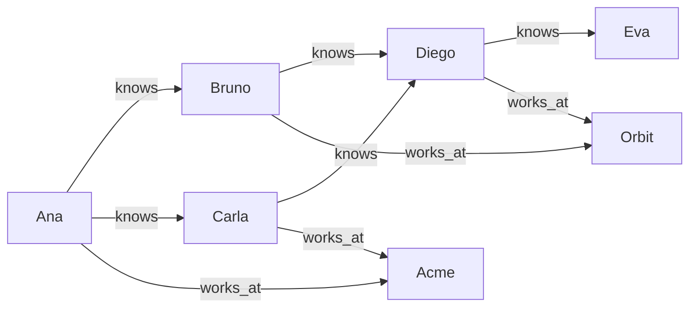

# Tutorial de GQ

GQ es el lenguaje con el que le haces preguntas a Grafeno y cambias sus datos. Una sentencia de GQ describe **patrones** de nodos y aristas, como los dibujarías en una pizarra:

```text
(ana:Person)-[:works_at]->(acme:Company)
```

Los paréntesis son **nodos** y los corchetes con flecha son **aristas** (también llamadas hechos). Este tutorial recorre el lenguaje una función a la vez. Cada página explica una función, muestra su sintaxis y da ejemplos junto con la respuesta exacta que devuelve Grafeno.

## Cómo seguirlo

Abre una consola con una base desechable y escribe o pega cada ejemplo:

```bash
grafeno shell --memory
```

Las sentencias terminan en `;` y pueden ocupar varias líneas. Los resultados se muestran como tablas:

```text run title="Ejemplo"
RETURN 'Hello, graph' AS greeting, 6 * 7 AS answer;
```

```text result title="Resultado"
 greeting     | answer
--------------+--------
 Hello, graph | 42
(1 row)
```

Para trabajar contra un motor instalado, conéctate con su archivo de configuración (`grafeno shell --config /etc/grafeno/grafeno.toml`) o envía las sentencias por HTTP (ver [Parámetros](parameters.md)). Grafeno Studio tiene un editor de consultas que muestra los mismos resultados como tabla o como dibujo.

## Los datos de ejemplo

La mayoría de las páginas parten del mismo grafo pequeño: cinco personas, las empresas donde trabajan cuatro de ellas y quién conoce a quién. Cada página lo crea de nuevo al inicio, así que cada una funciona sola:



```text run title="Ejemplo"
CREATE (ana:Person {name: 'Ana', age: 34, city: 'Lima'}),
       (bruno:Person {name: 'Bruno', age: 28, city: 'Quito'}),
       (carla:Person {name: 'Carla', age: 45, city: 'Lima'}),
       (diego:Person {name: 'Diego', age: 39, city: 'Bogotá'}),
       (eva:Person {name: 'Eva', age: 23, city: 'Quito'}),
       (acme:Company {name: 'Acme', sector: 'robotics'}),
       (orbit:Company {name: 'Orbit', sector: 'software'}),
       (ana)-[:works_at {since: 2019}]->(acme),
       (carla)-[:works_at {since: 2015}]->(acme),
       (bruno)-[:works_at {since: 2022}]->(orbit),
       (diego)-[:works_at {since: 2020}]->(orbit),
       (ana)-[:knows]->(bruno), (ana)-[:knows]->(carla),
       (bruno)-[:knows]->(diego), (carla)-[:knows]->(diego),
       (diego)-[:knows]->(eva);
```

```text result title="Resultado"
7 nodes created, 9 edges created
```

Revisa lo que hay:

```text run title="Ejemplo"
MATCH (p:Person) RETURN p.name, p.age, p.city ORDER BY p.name;
```

```text result title="Resultado"
 p.name | p.age | p.city
--------+-------+--------
 Ana    | 34    | Lima
 Bruno  | 28    | Quito
 Carla  | 45    | Lima
 Diego  | 39    | Bogotá
 Eva    | 23    | Quito
(5 rows)
```

## Las reglas en un solo lugar

- Cada nodo tiene al menos una **etiqueta** (`Person`) y cualquier número de **propiedades** (`name: 'Ana'`). Cada arista tiene exactamente una etiqueta y una dirección.
- Las palabras clave (`MATCH`, `match`) no distinguen mayúsculas; las etiquetas, los nombres de propiedades y las variables sí.
- Los textos van entre comillas simples o dobles. `//` inicia un comentario.
- Los ids los genera Grafeno (UUID). Se leen como `n.@id`; los nombres que empiezan con `@` son [pseudopropiedades](../reference/gq.md#pseudopropiedades), campos del motor y no datos tuyos.
- Cada sentencia se ejecuta en un **namespace** y en una transacción: o se aplican todos sus cambios o ninguno.

## Qué hay en este tutorial

| Parte | Páginas |
| --- | --- |
| Lo básico | [CREATE](create.md), [MATCH](match.md), [WHERE](where.md), [RETURN](return.md), [Agregación](aggregation.md), [WITH](with.md) |
| Cambiar datos | [SET y REMOVE](set-remove.md), [MERGE](merge.md), [DELETE](delete.md), [UNWIND y FOREACH](unwind-foreach.md) |
| Combinar consultas | [UNION y subconsultas](union-subqueries.md), [Caminos](paths.md) |
| Valores y funciones | [Textos](strings.md), [Números](numbers.md), [Listas y mapas](lists-maps.md), [Condiciones](conditions.md), [Fechas y duraciones](dates.md), [Viaje en el tiempo](time-travel.md) |
| Búsqueda | [Búsqueda de texto completo](full-text.md), [Texto parecido](similar-text.md); los vectores tienen [su propia sección](../vectors/index.md) |
| Esquema y operación | [Índices](indexes.md), [Restricciones](constraints.md), [Procedimientos](procedures.md), [Transacciones](transactions.md), [Namespaces](namespaces.md), [Suscripciones a eventos](events.md), [EXPLAIN, PROFILE y TRACE](explain-profile-trace.md), [Parámetros](parameters.md) |

Los algoritmos de grafos (caminos más cortos, centralidad, comunidades, flujos, simulaciones) están en [su propia sección](../algorithms/index.md).
