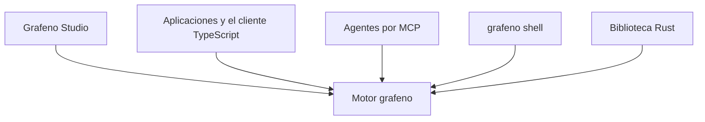

import useBaseUrl from '@docusaurus/useBaseUrl';

# Introducción

<a href={useBaseUrl('/img/grafeno-banner-es.svg')} aria-label="Abrir la imagen de Grafeno en resolución completa">
  
</a>

Grafeno es un motor de grafos escrito en Rust. Guarda entidades, documentos y hechos, conserva de dónde salió cada dato y cuándo fue cierto, y arma contexto combinando texto, vectores y relaciones.

Es memoria y base de conocimiento de agentes. Una aplicación puede usarlo embebido, por HTTP o por MCP.

Grafeno es solo el motor, como lo es un servidor de bases de datos. El binario `grafeno` ofrece la API HTTP, el servidor MCP, la consola y los comandos de administración. **Grafeno Studio**, la interfaz, es otro producto que se conecta a un motor por esa API, como cualquier otro cliente.

:::tip ¿Eres nuevo? Sigue la guía en orden
1. [Instalar Grafeno](./get-started/install.md) — el motor, en Windows o Linux, en unos minutos.
2. [Tu primer grafo](./get-started/first-graph.md) — personas, empresas y hechos con fechas, paso a paso en la consola.
3. [Grafeno Studio](./get-started/studio.md) — el mismo grafo, dibujado y editado en la app de escritorio.
4. Después, las ideas detrás: [Modelo de datos](./concepts/data-model.md), [Tiempo](./concepts/time.md), [Búsqueda y recall](./concepts/search-and-recall.md).
:::

## Para qué sirve

Un agente necesita más que el último mensaje. Necesita personas, organizaciones, documentos y hechos, con la fecha en que fueron ciertos y la fuente de la que salieron. Ante una pregunta, necesita un contexto que quepa en la ventana del modelo y que se pueda citar.

Grafeno es esa capa de datos.

- **Memoria de un agente.** Episodios, entidades y hechos en un archivo. El modelo extrae y embebe; Grafeno guarda, relaciona, busca y empaqueta el contexto. El motor no queda atado a un proveedor de modelos.
- **Conocimiento de una aplicación.** Un cliente puede sincronizar una nota, sus fragmentos y sus enlaces en una sola transacción. El cliente puede elegir el id de un nodo, así que repetir la escritura no duplica el dato.
- **Espacios aislados.** Cada dato vive en un namespace: una persona, una organización o un agente. Una consulta no cruza namespaces salvo que se lo pidas.
- **Varios servidores.** Un clúster con Raft replica las escrituras, elige líder, falla a otro miembro y reparte lecturas grandes. Un namespace entero puede vivir en un grupo distinto. Un namespace no se parte entre servidores.



## Características

### Grafo de propiedades

Un nodo tiene una o varias etiquetas y propiedades JSON. Una relación es dirigida, tiene etiqueta y también propiedades. Todo nodo lleva etiqueta: `CREATE` sin etiqueta se rechaza. Los identificadores son UUID v7, ordenados en el tiempo, generados por el motor.

Los datos viven en un archivo [redb](https://github.com/cberner/redb): ACID, varios lectores y un escritor por grupo Raft. Hay un backend en memoria para pruebas y agentes de corta vida.

### Dos tiempos en cada hecho

Grafeno no borra la historia al corregirla. En cada relación distingue cuándo el hecho fue cierto en el mundo y cuándo el motor lo supo.

| Eje | Campos | Pregunta |
| --- | --- | --- |
| Tiempo válido | `valid_from`, `valid_to` | ¿Cuándo fue cierto? |
| Tiempo de registro | `recorded_at`, `expired_at` | ¿Cuándo se enteró el motor, y cuándo se retractó? |

- Sin cláusula de tiempo, una lectura ve el conocimiento actual: relaciones que no se han retractado, sea cual sea su tiempo válido.
- `VALID AT t` deja los hechos ciertos en ese instante (`valid_from <= t < valid_to`).
- `KNOWN AT t` muestra lo que el motor sabía entonces, incluidas retractaciones posteriores.
- Invalidar cierra el tiempo válido: el mundo cambió. Retraer cierra el tiempo de registro: el dato era un error. Borrar existe, y es otra operación.

`t` es una fecha ISO 8601, un valor como `datetime()`, o microsegundos desde el epoch de Unix.

### Procedencia

Nodos y relaciones guardan `sources`: los nodos de los que provienen, como un episodio, un documento, un fragmento o una conversación. Sirve para citar y para heredar permisos. Cada escritura anota la cuenta que la hizo (`recorded_by`).

### GQ

GQ es el lenguaje de consulta: un lenguaje declarativo de patrones de grafos, con el tiempo, la retractación y pseudo-propiedades para lo que no es una propiedad (`@id`, `@text`, `@embedding`, `@valid_from`, `@recorded_by`, …). Corre en la consola, en `POST /v1/{namespace}/query`, en la herramienta MCP `query` (solo lectura) y desde Rust.

```text
CREATE (a:Person {name: 'Ana'})
  -[:works_at {@valid_from: '2024-01-01'}]->
  (h:Organization {name: 'Hospital Central'})
RETURN a.name, h.name;
```

```text
MATCH (p:Person)-[r:works_at]->(o:Organization)
VALID AT '2024-06-01'
RETURN p.name, o.name, r.@valid_from;
```

Cubre patrones, filtros, agregaciones, escrituras, `OPTIONAL MATCH`, `MERGE`, `WITH`, `UNWIND` y `UNION`, además de índices y algoritmos de caminos, centralidad, comunidades y similitud. Tres decisiones importan desde el principio: todo nodo lleva etiqueta; un camino de longitud variable llega a cada nodo destino una sola vez, por el camino más corto; el id es un UUID, no un entero. Los clientes se conectan por la API HTTP o MCP: no hay protocolo binario.

La referencia completa sigue en el repositorio del motor, en [`docs/query-language.md`](https://github.com/grafenodb/grafeno/blob/main/docs/query-language.md), hasta que pase a este sitio.

### Recuperación híbrida

Para una pregunta, el motor puede juntar tres señales y fundirlas con reciprocal rank fusion (`k = 60`):

1. **Texto**, con BM25. El índice vive en el mismo archivo y en la misma transacción que el grafo.
2. **Vectores**, con HNSW y similitud coseno. El cliente envía el embedding. La dimensión del namespace queda fijada por el primer vector.
3. **El grafo.** Los mejores resultados ceden puntuación a sus vecinos, así que aparecen personas, organizaciones o etiquetas que no tienen texto ni vector. Cada resultado dice por qué volvió: texto, vector o grafo.

El contexto se empaqueta en un presupuesto de tokens. Por defecto se estiman cuatro caracteres por token; la biblioteca Rust acepta el contador del modelo. Una parte del presupuesto se reserva para hechos entre los nodos recuperados, con su tiempo válido.

El tokenizador pasa el texto a forma NFD, quita acentos y mayúsculas, parte por lo que no es letra ni número, y descarta términos de una letra y stopwords en español e inglés. Todavía no hay stemming.

### Memoria, sin llamar a un modelo

El motor resuelve entidades, propone duplicados, registra fusiones que se pueden deshacer y resume comunidades. La extracción con un modelo de lenguaje queda fuera del núcleo: la hace el cliente, o `grafeno extract` prepara los textos nuevos y cambiados para revisión.

Por MCP, un agente tiene herramientas directas: `remember`, `recall`, `context`, `relate`, `update`, `forget` y `get_node`, más `query`, `merge`, `undo_merge`, `overview`, `changes` y el resumen de comunidades; `ingest` para documentos, conversaciones y código; `checkpoint` y `resume` para retomar el trabajo en otra sesión; `timeline`, `contradictions` y `feedback`. `context` devuelve texto compacto, listo para meter en el prompt. `forget` puede invalidar un hecho, retractarlo o borrarlo; invalidar es lo habitual cuando el mundo cambió.

### Quién puede ver qué

Hay cuentas que inician sesión y cuentas de servicio con clave de API. Un rol concede o deniega privilegios. La denegación gana. El privilegio puede acotarse a un namespace, a los que empiezan por un prefijo, a una etiqueta, a una propiedad o a los registros que cumplen una condición.

Lo que una cuenta no puede leer no sale en la respuesta: listados, búsquedas, recorridos, GQ, algoritmos y exportaciones lo omiten como si no existiera. Una escritura que tocaría algo prohibido falla entera. Hay un registro de auditoría de inicios de sesión, cambios de cuentas y roles, y peticiones rechazadas.

Sin token y sin cuentas, quien alcance el puerto entra. El primer alta tiene que ser un superusuario; a partir de ahí toda petición lleva credencial. El token del servidor (`grafeno.toml` o `--token`) es una llave de emergencia que puede hacerlo todo.

### Clúster

Varios procesos `grafeno` se sincronizan con Raft, dentro del propio binario: no hace falta un servicio de coordinación aparte. Hay elección de líder, recuperación ante fallos, lecturas linealizables y lecturas grandes repartidas entre miembros. Cada grupo replica bases enteras y, como mucho, coloca namespaces enteros en grupos distintos.

### Operación

El mismo binario administra el archivo: namespaces, estadísticas, comprobación de integridad (incluye una estimación del recall de los vectores), reconstrucción de índices, exportación e importación JSON Lines, extracción, y un respaldo consistente que puede tomarse con el servidor en marcha.

Por defecto el servicio escucha en `127.0.0.1:7810`. La configuración persistente está en `grafeno.toml`.

## Cómo se usa

| Forma | Entrada | Cuándo |
| --- | --- | --- |
| Biblioteca Rust | Crates `grafeno` y `grafeno-memory` | Dentro del mismo proceso, como una base de datos embebida. |
| Servidor HTTP | `grafeno serve` | Aplicaciones y Studio. JSON bajo `/v1/{namespace}/…`. |
| MCP | `grafeno mcp` | Agentes. JSON-RPC por la entrada estándar. |
| Consola | `grafeno shell` | Consultas GQ y administración, sobre un archivo o contra un servidor. |
| SDK de TypeScript | `@grafenodb/client` (npm) | Aplicaciones JavaScript y TypeScript. Studio lo usa. |
| Grafeno Studio | Aplicación web, React y Vite | Explorar, editar, dibujar el grafo, ejecutar GQ, buscar, mantener la memoria y administrar el acceso. |
| Grafeno Desktop | Tauri alrededor de Studio | La misma interfaz en ventanas nativas. Abre archivos de base con el motor instalado y habla con cualquier motor por HTTP. |

Un archivo `.redb` solo puede estar abierto en un proceso. El servidor HTTP y un proceso MCP no comparten archivo. Para probar sin disco:

```bash
grafeno serve --memory
```

Esos datos desaparecen al cerrar el proceso. Con el binario disponible, una consola local:

```bash
grafeno shell --db ejemplo.redb -n demo
```

Y un agente con su propio archivo:

```bash
grafeno mcp --db agente.redb
```

La consola también puede conectarse al servidor que ya tiene el archivo abierto (`grafeno shell --url http://127.0.0.1:7810`). En un clúster, `--url` acepta varios miembros separados por comas.

### Qué hace Studio

Studio hace el trabajo sin terminal. Se conecta a la API del motor, en la misma máquina o en otra.

- **Resumen.** Namespaces, conteos por etiqueta y acciones rápidas.
- **Explorador.** Filtra por etiqueta, nombre o texto. Crea nodos y edita nombre, etiquetas, propiedades tipadas, texto e importancia. Añade, cierra, retracta o borra hechos.
- **Grafo.** Un lienzo con física: arrastrar, fijar, seleccionar varios, conectar, expandir vecinos y viajar con «válido en». Colorea por comunidad y tamaño por centralidad, calculados sobre el namespace entero.
- **Scripts.** Un editor de GQ con pestañas, resaltado, completado, esquema, resultados en tabla, JSON, grafo o gráfica, y export a CSV o JSON.
- **Búsqueda.** Texto, recall con sus señales, y contexto dentro de un presupuesto de tokens.
- **Memoria.** Duplicados para fusionar, recuerdos débiles para archivar y grupos para consolidar.
- **Administración.** La cuenta conectada, claves, índices, comprobación, reconstrucción, importación, exportación y respaldo.

`Ctrl+K` abre la paleta de comandos. El mismo build estático puede alojarse en cualquier servidor; el motor tiene que arrancar con `--cors-origin` de ese origen.

## Cómo está hecho el motor

| Crate | Responsabilidad |
| --- | --- |
| `grafeno-core` | Nodos, relaciones, identificadores y tiempo. |
| `grafeno` | Almacenamiento redb, transacciones, índices, recorridos y algoritmos. |
| `grafeno-memory` | Recuperación híbrida, contexto, extracción y mantenimiento de memoria. |
| `grafeno-query` | Parser, planificación y ejecución de GQ. |
| `grafeno-server` | API HTTP, MCP, consola y administración: el binario `grafeno`. |
| `grafeno-raft`, `grafeno-cluster` | Raft y el clúster. |

Los índices de texto y de vectores se escriben en la misma transacción que el grafo. Un nodo, su texto y su embedding quedan de acuerdo, y una escritura fallida no deja entradas viejas.

La versión del workspace es 0.1.0. Rust del workspace: edition 2024, rust-version 1.88. La licencia sigue como decisión abierta en el [diseño](https://github.com/grafenodb/grafeno/blob/main/DESIGN.md).

## Qué no hace

- No calcula embeddings. Los manda el cliente.
- No es un almacén distribuido de un solo namespace partido en trozos.
- No tiene protocolo binario, y GQ crece con lo que hace falta en vez de cubrir toda forma de consulta posible.
- No trae una interfaz integrada. Studio es un cliente separado.
- No elige el modelo de lenguaje. La extracción queda fuera del núcleo.

## Esta documentación

Este sitio, `grafeno-docs`, es la documentación del producto, aparte del repositorio del motor y del de Studio. Esta introducción es la primera página. El sitio está en inglés, y el español se elige en el menú de idioma.

Continúa con [Instalar Grafeno](./get-started/install.md) y [Tu primer grafo](./get-started/first-graph.md), o elige una integración mediante la [API HTTP](./guides/http-api.md), [MCP](./guides/mcp.md) o el [cliente TypeScript](./clients/typescript.md).

Para aprender el lenguaje de consultas una función a la vez, sigue el [tutorial de GQ](./gq/index.md): cada página muestra una sentencia y la respuesta que da el motor. [Vectores](./vectors/index.md) trata los embeddings, los índices vectoriales y cómo dimensionarlos, y [Algoritmos de grafos](./algorithms/index.md) tiene un ejemplo resuelto de cada uno de los 40 algoritmos.

Grafeno se desarrolla en la [organización grafenodb](https://github.com/grafenodb). El símbolo son tres anillos de carbono de una red de grafeno.
